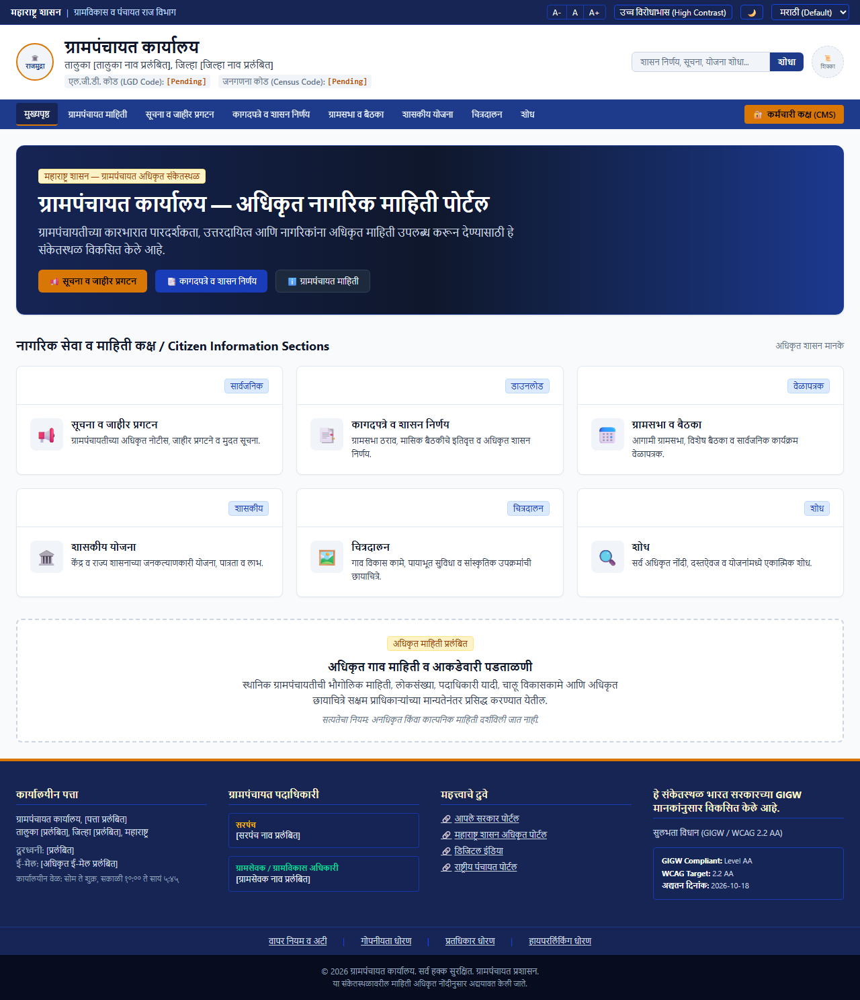
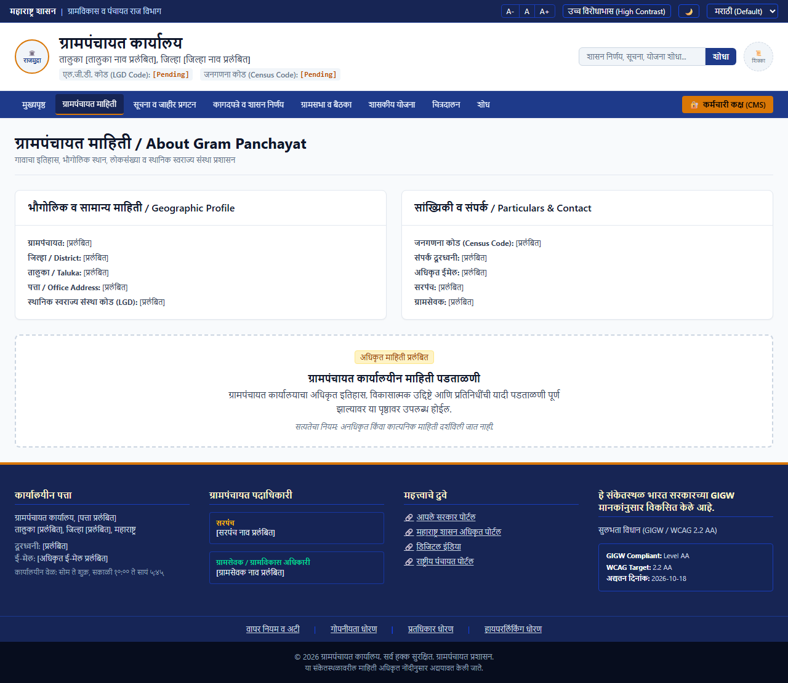
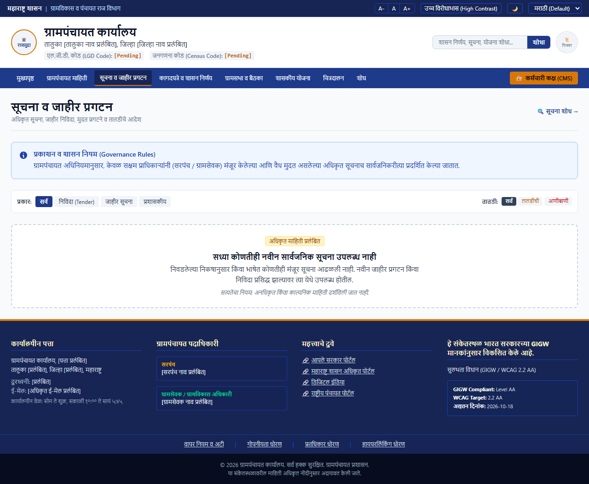
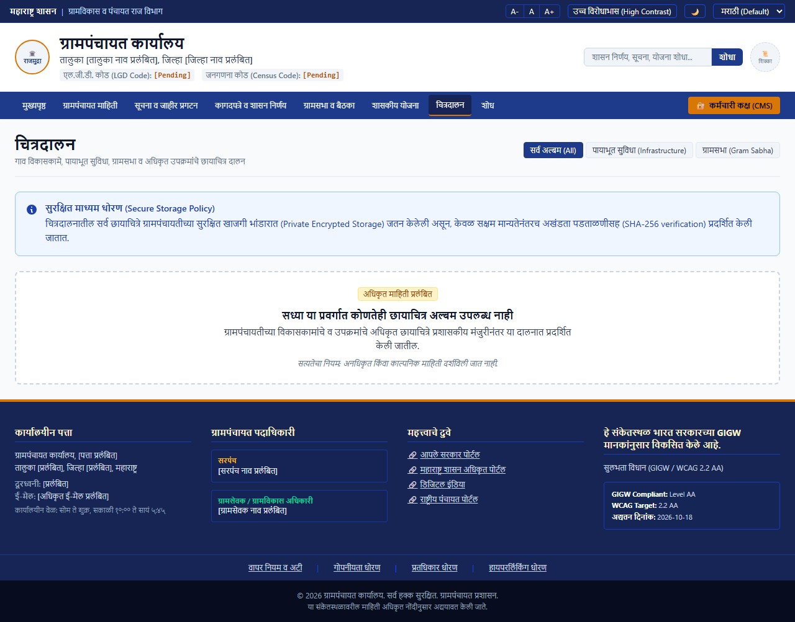
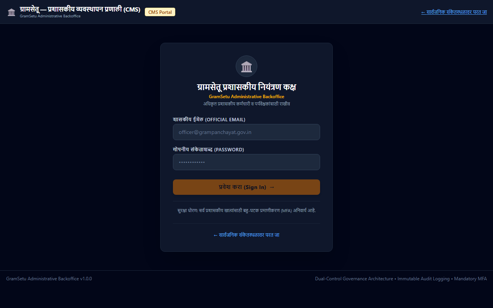
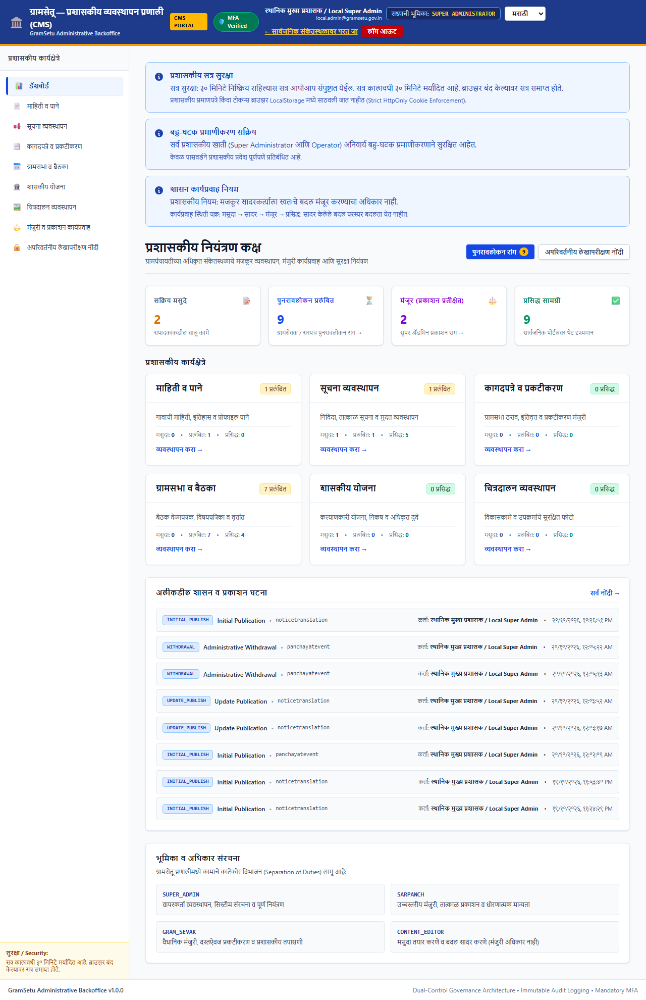
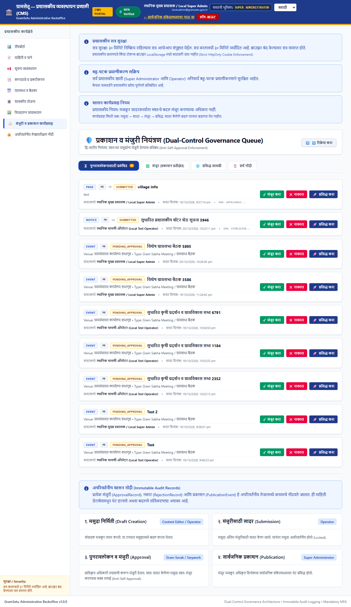
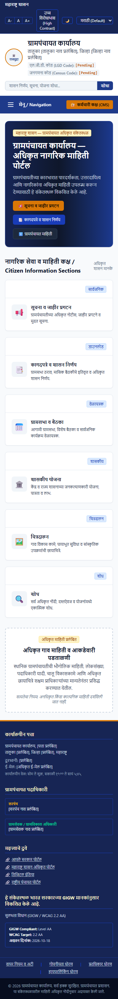
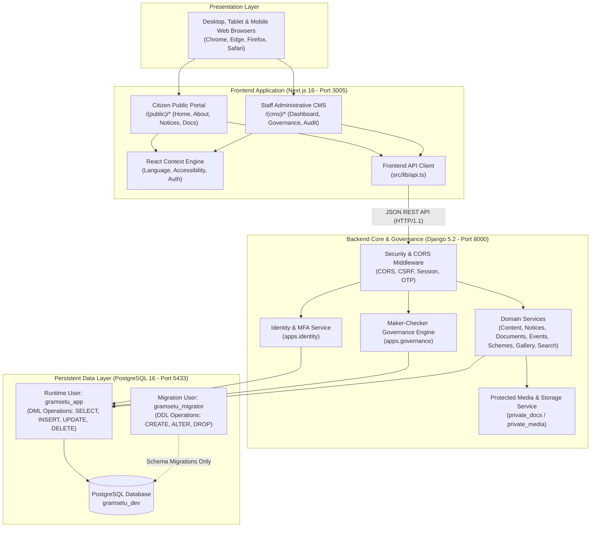
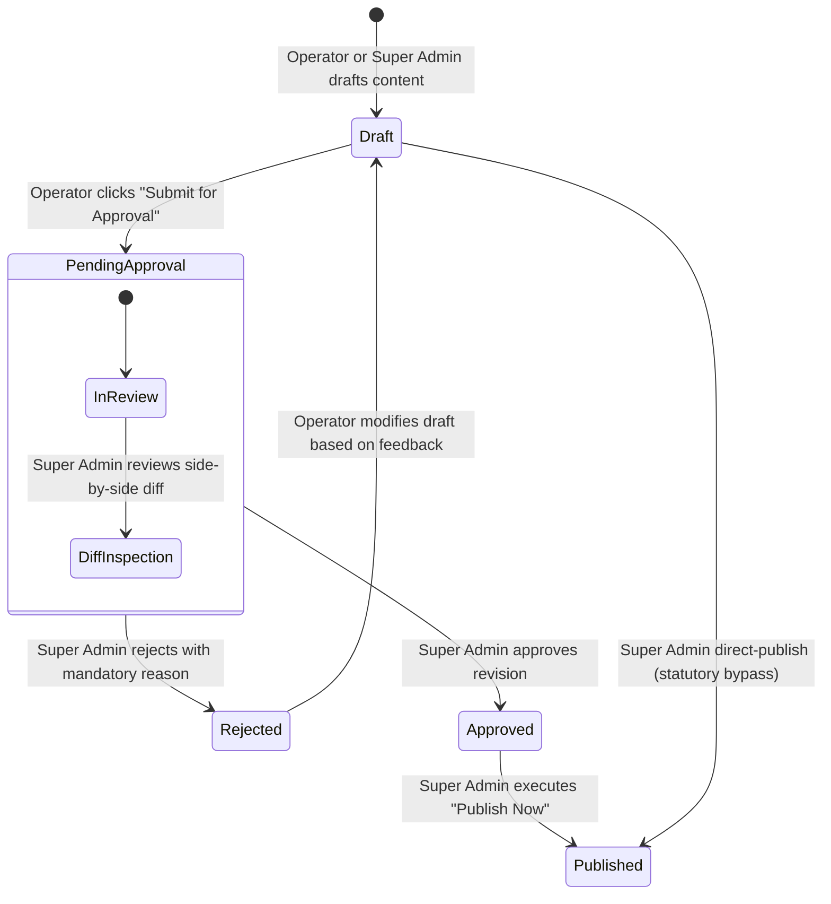

# GramSetu — A Digital Gram Panchayat Information and Governance Portal



[](#technology-stack)
[](#backend-technologies)
[](#frontend-technologies)
[](#technology-stack)
[](#database-architecture)
[](#accessibility--multilingual-support)

---

## 1. Project Overview

**GramSetu** (Devanagari: **ग्रामसेतू**) is an enterprise-grade, trilingual (Marathi, Hindi, English) digital public information and administrative governance portal engineered specifically for Indian Gram Panchayats. Anchored on **Narayangaon Gram Panchayat** (LGD Code: `549493`, Census Code: `540493`, Paithan Tehsil, Chhatrapati Sambhajinagar District, Maharashtra), GramSetu bridges the rural digital divide by replacing physical notice boards and opaque paper ledgers with an authenticated, verifiable, and citizen-accessible rural governance platform.

### Purpose and Vision
- **Eliminate Rural Information Poverty**: Democratize access to government resolutions, public tenders, welfare schemes, and village meetings 24/7 for villagers residing in distant hamlets (*wadis*).
- **Enforce Institutional Accountability**: Implement a statutory dual-custody "Maker-Checker" governance workflow separating clerical data entry operators from the gazetted Gramsevak (Village Development Officer).
- **Guarantee Cryptographic Integrity**: Safeguard public records and orders using automated SHA-256 cryptographic checksums.
- **Ensure Universal Digital Inclusion**: Adhere strictly to Guidelines for Indian Government Websites (GIGW 3.0) and Web Content Accessibility Guidelines (WCAG 2.2 Level AA).

---

## 2. Key Features

- **Public Citizen Portal**:
  - Trilingual interface defaulting to Marathi (`mr`) with instant toggling to Hindi (`hi`) and English (`en`).
  - Wikipedia-style **14-Section Village Knowledge Portal** documenting local history, geographic coordinates, demographics, administration, agriculture, water resources, and emergency contacts.
  - Proactive statutory disclosure of notices, public tenders, and resolutions under RTI Act 2005 Section 4(1)(b).
  - Central and State government welfare schemes directory with structured eligibility criteria, required documents checklists, and official portal links.
  - Responsive 3-column village photo gallery with single-entry multilingual captions and interactive lightbox modal.
  - Unified PostgreSQL full-text search across all published records.
- **Administrative Staff CMS (`/cms`)**:
  - Role-Based Access Control (RBAC) supporting **Super Admin** (Gramsevak) and **Operator** (Computer Operator).
  - Dual-custody "Maker-Checker" review queue with side-by-side textual diff inspection.
  - Two-Factor Authentication (MFA) via single-use 6-digit Email OTP tokens (`django-otp`).
  - Dedicated development OTP retrieval commands (`superadmin_otp`, `operator_otp`).
  - Comprehensive Content, Notice, Document, Event, and Scheme management engines.
  - Immutable governance audit ledger recording all approvals, rejections, and publications.
- **Universal Multi-Device Access**:
  - Fully responsive, mobile-first design optimized for desktop workstations, tablets, and smartphones.

---

## 3. Application Screenshots

| Citizen Public Homepage | Village Knowledge Portal (14 Sections) |
|:---:|:---:|
|  |  |

| Statutory Notices & Tenders | Responsive Photo Gallery |
|:---:|:---:|
|  |  |

| Staff Two-Factor Login Gate | Super Admin Operational Dashboard |
|:---:|:---:|
|  |  |

| Maker-Checker Governance Queue | Responsive Mobile Viewport |
|:---:|:---:|
|  |  |

---

## 4. Technology Stack

### Frontend Technologies
- **Framework**: Next.js 16.4.2 (App Router architecture, SSR/SSG hybrid rendering)
- **UI Library**: React 19.3.0 & React DOM 19.3.0
- **Language**: TypeScript 5.0 (Strict type safety, 0 compilation errors)
- **Styling**: Tailwind CSS v4.0 with `@tailwindcss/turbopack`
- **Icons & Visuals**: Lucide React
- **State Management**: React Context API (`LanguageContext`, `AccessibilityContext`, `AuthContext`)

### Backend Technologies
- **Framework**: Django 5.2.18 LTS (Python 3.11)
- **Architecture**: 12 Domain Applications under `apps/`
- **Database Adapter**: psycopg2-binary 2.9.10
- **Authentication**: `django-otp` 1.7.5 (`EmailDevice`) with PBKDF2 SHA-256 password hashing
- **Security Middleware**: Custom CORS validation (`DeliberateCorsMiddleware`), double-submit CSRF cookie protection

### Database Technology
- **Engine**: PostgreSQL 16 Alpine running in Docker Compose (`127.0.0.1:5433`)
- **Least-Privilege Role Model**:
  - `postgres`: Bootstrap account for initial container setup.
  - `gramsetu_migrator`: Schema owner role executing DDL migrations (`CREATE`, `ALTER`, `DROP`).
  - `gramsetu_app`: Runtime DML-only role (`SELECT`, `INSERT`, `UPDATE`, `DELETE`; `REVOKE CREATE ON SCHEMA public`).
  - `gramsetu_test_runner`: Restricted strictly to `gramsetu_test`.
  - `gramsetu_backup`: Dedicated non-locking backup role equipped with `pg_read_all_data`.

---

## 5. System Architecture



---

## 6. Main Modules Overview

| Module Name | Route | Purpose | Key Capabilities |
|:---|:---|:---|:---|
| **Public Homepage** | `/` | Village gateway | Emergency banner, latest notices, upcoming meetings, office-holder contacts |
| **About Panchayat** | `/about` | Village Knowledge Portal | 14 trilingual sections, sticky TOC, official seal zone, footnote citations |
| **Notices & Orders** | `/notices` | Statutory announcements | Urgency badges, category filters, PDF downloads, auto-expiry archiving |
| **Disclosed Documents**| `/documents`| RTI public records | Resolutions, budgets, and tenders streamed with SHA-256 verification |
| **Meetings & Events** | `/events` | Gram Sabha calendar | Meeting schedules, venue details, and mandatory 6-hour cancellation alerts |
| **Welfare Schemes** | `/schemes` | Government subsidies | Criteria, quantifiable benefits, required documents, and official portal links |
| **Photo Gallery** | `/gallery` | Development media | Responsive 3-column album grid with interactive lightbox viewing |
| **Unified Search** | `/search` | Full-text discovery | PostgreSQL full-text search indexing across Marathi, Hindi, and English |
| **CMS Login Gate** | `/cms` | Administrative entry | Credentials verification followed by 6-digit Email OTP challenge |
| **CMS Dashboard** | `/cms` | Operational cockpit | Role-aware metrics, pending approval counts, and quick action links |
| **Governance Queue** | `/cms/governance`| Maker-Checker queue | Side-by-side revision diffs, approval engine, and rejection with reason |
| **Audit Ledger** | `/cms/audit` | Non-repudiation log | Timestamped immutable records of all approvals, rejections, and publications |

---

## 7. Maker-Checker Governance Workflow

GramSetu enforces a strict institutional separation of duties:



- **Operator (Maker)**: Drafts notices, documents, schemes, and photo albums. Submits revisions for administrative review. Cannot approve their own submissions (`is_self_approval` checks block operator approvals).
- **Super Admin / Gramsevak (Checker)**: Evaluates pending submissions in the Governance Queue, inspects textual diffs, approves, rejects with mandatory justification, or executes direct publishing.
- **Sarpanch Democratic Isolation**: The elected Sarpanch holds **no technical login account**, ensuring official records and financial gazettes remain protected from political tampering.

---

## 8. Security & Cryptographic Integrity

1. **Password Hashing**: PBKDF2 SHA-256 with 600,000 iterations and per-user cryptographic salts.
2. **Two-Factor Authentication**: Single-use 6-digit numeric OTPs via `django-otp` EmailDevice with 300-second expiration, 60-second cooldown, and immediate token invalidation upon verification.
3. **Brute-Force Lockout**: 5 consecutive failed login attempts trigger an automatic 15-minute account lockout (HTTP 423 Locked).
4. **Session Security**: 30-minute inactivity expiration (`SESSION_COOKIE_AGE = 1800`), `SESSION_EXPIRE_AT_BROWSER_CLOSE = True`, and `HttpOnly`, `SameSite=Lax` cookies.
5. **CSRF Protection**: Double-submit cookie verification requiring `X-CSRFToken` on all mutating requests.
6. **Filesystem Isolation**: Document binaries and photographs are stored in private directories outside the web server root (`private_docs/` and `private_media/gallery/`).
7. **Cryptographic SHA-256 Verification**: Every file upload generates a 256-bit SHA-256 hash. Downloads are verified prior to streaming, instantly flagging unauthorized file tampering on disk.

---

## 9. Universal Accessibility & Responsive Design

GramSetu is designed from the ground up to ensure seamless usability across devices:
- **Responsive Layout**: Fluid grids and CSS Flexbox layouts adapt dynamically to desktop monitors, tablets, and smartphones.
- **GIGW 3.0 & WCAG 2.2 AA Compliance**: Contrast ratios exceeding 7:1, tri-level text scaling (100%, 110%, 120%), semantic HTML5 landmarks, and skip-to-content links.
- **Touch-Friendly Controls**: Minimum 44x44px interactive tap targets, accessible mobile drawer navigation, and swipe-friendly photo carousels.

---

## 10. Project Directory Structure

```text
GramSetu/
├── .env.example                     # Sanitized environment variable configuration template
├── .gitignore                        # Comprehensive Git ignore rules (builds, secrets, temp files)
├── Dockerfile                        # Multi-stage production container definition
├── docker-compose.yml                # Containerized PostgreSQL 16 Alpine configuration
├── manage.py                         # Django administrative CLI
├── requirements.txt                  # Pinned Python backend dependencies
├── requirements-prod.txt             # Production dependencies (Gunicorn, etc.)
│
├── apps/                             # 12 Modular Django Domain Applications
│   ├── audit/                        # Immutable application audit logging
│   ├── content/                      # 14-section Village Knowledge Portal & revisions
│   ├── core/                         # Health probes, API router, CORS middleware
│   ├── documents/                    # Protected documents, versioning, SHA-256 storage
│   ├── events/                       # Meeting calendar & cancellation workflows
│   ├── gallery/                      # Photo albums & protected streaming views
│   ├── governance/                   # Maker-Checker queue & approval engine
│   ├── identity/                     # Custom User model, RBAC, MFA OTP commands
│   ├── notices/                      # Statutory notices & emergency publishing
│   ├── schemes/                      # Welfare schemes directory & criteria
│   ├── search/                       # Unified PostgreSQL full-text search index
│   └── site_config/                  # Panchayat profile, LGD code, seal zone
│
├── config/                           # Django Project Configuration
│   ├── settings.py                   # Hardened Django settings & role configuration
│   ├── urls.py                       # Root URL router
│   ├── wsgi.py                       # WSGI entrypoint
│   └── test_runner.py                # Database test runner with isolation enforcement
│
├── docs/                             # Canonical Technical Documentation
│   ├── ARCHITECTURE.md               # Detailed system topology & REST design
│   ├── FEATURES.md                   # Comprehensive public & CMS features
│   ├── DATABASE.md                   # Relational schema & least-privilege model
│   ├── SECURITY.md                   # Authentication, MFA, and media integrity
│   ├── API_DOCUMENTATION.md          # REST API endpoints & payload specifications
│   ├── SETUP_GUIDE.md                # Local installation & execution manual
│   └── screenshots/                  # Curated application screenshot gallery
│
├── frontend/                         # Next.js 16 Client Application
│   ├── package.json                  # Node.js dependencies (Next.js 16, React 19)
│   ├── tsconfig.json                 # Strict TypeScript configuration
│   ├── next.config.ts                # Next.js build and proxy configuration
│   ├── src/
│   │   ├── app/
│   │   │   ├── (public)/             # Citizen portal routes (/, /about, /notices, etc.)
│   │   │   └── (cms)/                # Administrative CMS routes (/cms, /governance, etc.)
│   │   ├── components/               # UI components (Knowledge, Public, CMS, UI)
│   │   ├── context/                  # React Contexts (Language, Accessibility, Auth)
│   │   └── lib/                      # API client service & TypeScript definitions
│   └── tests/e2e/                    # Playwright browser end-to-end test suites
│
└── scripts/                          # Operational Utility Scripts
    ├── backup.py                     # Non-locking logical database backup script
    └── sync_trilingual_knowledge.py  # Village Knowledge Portal seeding script
```

---

## 11. Installation & Local Development Setup

### 11.1 Prerequisites
- **Python**: 3.11+
- **Node.js**: 20+ (LTS) & npm 10+
- **Docker Desktop**: 26+ (Running Linux containers)

### 11.2 Environment Configuration
```powershell
# 1. Copy the sanitized configuration template
copy .env.example .env

# 2. Configure local development passwords in .env
```

### 11.3 Database Setup
```powershell
# 1. Start isolated PostgreSQL 16 container on port 5433
docker compose up -d

# 2. Apply database migrations using schema owner role (gramsetu_migrator)
$env:DB_ROLE="migrator"
.venv\Scripts\python.exe manage.py migrate
Remove-Item env:DB_ROLE

# 3. Seed testing accounts and 14-section Village Knowledge Portal
.venv\Scripts\python.exe manage.py seed_testing_accounts
.venv\Scripts\python.exe scripts/sync_trilingual_knowledge.py
```

### 11.4 Backend Service Startup
```powershell
# 1. Create and activate virtual environment
python -m venv .venv
.\.venv\Scripts\Activate.ps1
python -m pip install -r requirements.txt

# 2. Start Django development server (Port 8000)
.venv\Scripts\python.exe manage.py runserver 127.0.0.1:8000 --noreload
```

### 11.5 Frontend Service Startup
```powershell
# In a new terminal:
cd frontend
npm install
npx next dev -p 3005
```

Access the interfaces:
- **Citizen Public Portal**: `http://localhost:3005`
- **Staff Administrative CMS**: `http://localhost:3005/cms`
- **Backend API Root**: `http://127.0.0.1:8000/api/`
- **Liveness Probe**: `http://127.0.0.1:8000/health/`
- **Readiness Probe**: `http://127.0.0.1:8000/ready/`

### 11.6 Development OTP Commands
In development (`settings.DEBUG == True`), retrieve single-use MFA codes directly from the terminal without external SMTP:
```powershell
# Super Admin OTP (Gramsevak)
.venv\Scripts\python.exe manage.py superadmin_otp

# Operator OTP (Computer Operator)
.venv\Scripts\python.exe manage.py operator_otp

# Raw 6-digit code for automation/scripts
.venv\Scripts\python.exe manage.py superadmin_otp --raw
```

---

## 12. Current Project Scope vs. Future Roadmap

### Implemented & Verified Capabilities
- Full-stack decoupled web architecture (Next.js 16 + Django 5.2 + PostgreSQL 16).
- 14-section trilingual Village Knowledge Portal in Official Light Theme.
- Maker-Checker dual-custody content review queue with side-by-side diffs.
- Email OTP Multi-Factor Authentication with brute-force defense.
- Cryptographic SHA-256 integrity verification on public documents and photographs.
- Full compliance with GIGW 3.0 and WCAG 2.2 AA accessibility standards across desktop, tablet, and mobile browsers.
- 305 backend unit/integration tests and 42 Playwright browser E2E test suites.

### Future Roadmap
- **Android Mobile Application**: Development of a dedicated Android mobile application to extend GramSetu's accessibility to smartphone users.
- **Citizen Property & Water Tax Gateway**: State treasury banking integration (Maharashtra e-Gras).
- **Citizen Grievance Redressal Portal**: Bidirectional issue ticketing integrated with Aaple Sarkar.
- **SMS OTP Gateway**: Maharashtra CDAC SMS integration for low-bandwidth cellular environments.
- **DigiLocker Integration**: Verification of resident identity and caste/income certificates.

---

## 13. Contributing & License

### Contributing
This repository represents the official academic project submission for GramSetu. External contributions, pull requests, and forks are welcome for academic research and public governance evaluations. Please review [docs/SETUP_GUIDE.md](docs/SETUP_GUIDE.md) before submitting pull requests.

### License
This project currently has no specified open-source license. All rights are reserved by the project author and copyright holders. Academic evaluators and institutions are granted permission to inspect, review, and evaluate the source code for examination purposes.

---

## 14. Acknowledgements

- **Anchor Institution**: Narayangaon Gram Panchayat, Paithan Tehsil, Chhatrapati Sambhajinagar District, Maharashtra.
- **Statutory Frameworks**: Maharashtra Village Panchayats Act (1959), Guidelines for Indian Government Websites (GIGW 3.0), Right to Information Act (2005).
- **Technical Standards**: Ministry of Panchayati Raj Local Government Directory (LGD), Web Content Accessibility Guidelines (WCAG 2.2 Level AA).
