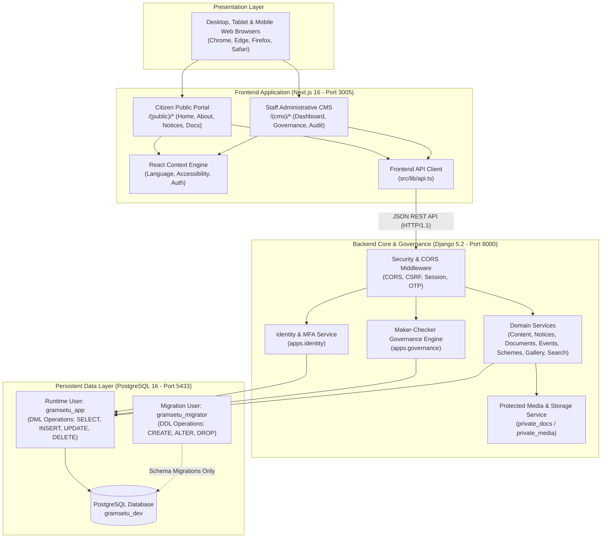
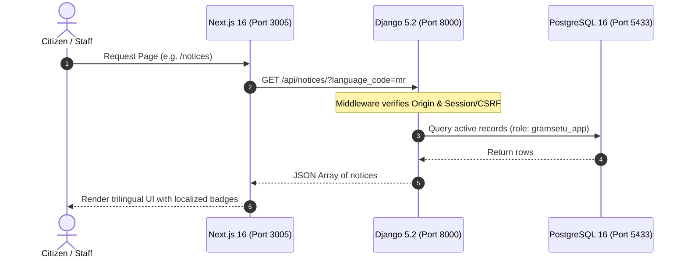

# GramSetu — System Architecture & Technical Specifications

**Project Title:** GramSetu – A Digital Gram Panchayat Information and Governance Portal  
**Anchor Village:** Narayangaon Gram Panchayat (LGD Code: `549493`, Paithan, Chhatrapati Sambhajinagar, Maharashtra)  

---

## 1. System Topology Overview

GramSetu is engineered as a decoupled, 3-tier enterprise web platform:
1. **Presentation Layer**: 
   - A reactive Next.js 16 (React 19, TypeScript, Tailwind CSS v4) application running on port `3005`, providing both the Public Citizen Portal and Staff Administrative CMS. Designed with mobile-first responsive architecture supporting desktop monitors, tablets, and mobile web browsers.
2. **Business Logic & Governance Layer**: 
   - A high-integrity Python 3.11 and Django 5.2 LTS backend running on port `8000`, organized into 12 Domain Applications. It exposes REST JSON endpoints under `/api/` and executes a dual-custody Maker-Checker publishing workflow.
3. **Persistent Data Layer**: 
   - A containerized PostgreSQL 16 Alpine database binding strictly to `127.0.0.1:5433`, enforcing 4-tier least-privilege role separation between migrations, runtime application queries, test runs, and logical backups.

---

## 2. Frontend / Backend Communication & REST Architecture

All communication between the Next.js frontend and Django backend occurs over standard HTTP/1.1 REST endpoints using JSON payloads:

- **Cross-Origin Security**: Enforced via `apps.core.middleware.DeliberateCorsMiddleware`. Requests validate `Origin` against `CORS_ALLOWED_ORIGINS` (`http://localhost:3000`, `http://localhost:3005`), sending credentials (`Access-Control-Allow-Credentials: true`).
- **CSRF Protection**: All state-changing methods (`POST`, `PUT`, `DELETE`) require a valid `X-CSRFToken` header matching the `csrftoken` cookie issued by `/api/auth/csrf/`.
- **Session State**: Authenticated sessions are tracked via an encrypted `sessionid` cookie set to `HttpOnly` and `SameSite=Lax`.

---

## 3. Universal Client Accessibility & Responsive Design

The presentation tier is designed according to Guidelines for Indian Government Websites (GIGW 3.0) and Web Content Accessibility Guidelines (WCAG 2.2 Level AA):

1. **Fluid Responsive Grids**: Flexbox and CSS Grid layouts dynamically reflow across desktop viewports (1280px+), tablet viewports (768px-1024px), and mobile viewports (320px-640px).
2. **Mobile Navigation Drawer**: Accessible touch-friendly slide-out drawer on smaller screens with focus trapping and ARIA attributes.
3. **Trilingual Runtime Rendering**: Instant client-side localization between Marathi (`mr`), Hindi (`hi`), and English (`en`) without full page reloads.
4. **WCAG 2.2 AA Contrast Compliance**: High-contrast dark theme mode offering > 7:1 contrast ratio for users with visual impairments.
5. **Dynamic Text Scaling**: Tri-level root REM scaling (`100%`, `110%`, `120%`) respecting browser accessibility preferences.

---

## 4. Future Scope

The following capabilities are planned for subsequent development phases and are not currently implemented:

- **Android Mobile Application**: Development of a dedicated Android mobile application to extend GramSetu's accessibility to smartphone users.
- **Biometric Citizen Service Kiosks**: Integration with physical Gram Panchayat touchscreen information kiosks.
- **Automated WhatsApp / SMS Gateway**: Push notifications for statutory Gram Sabha summons and urgent disaster alerts.
