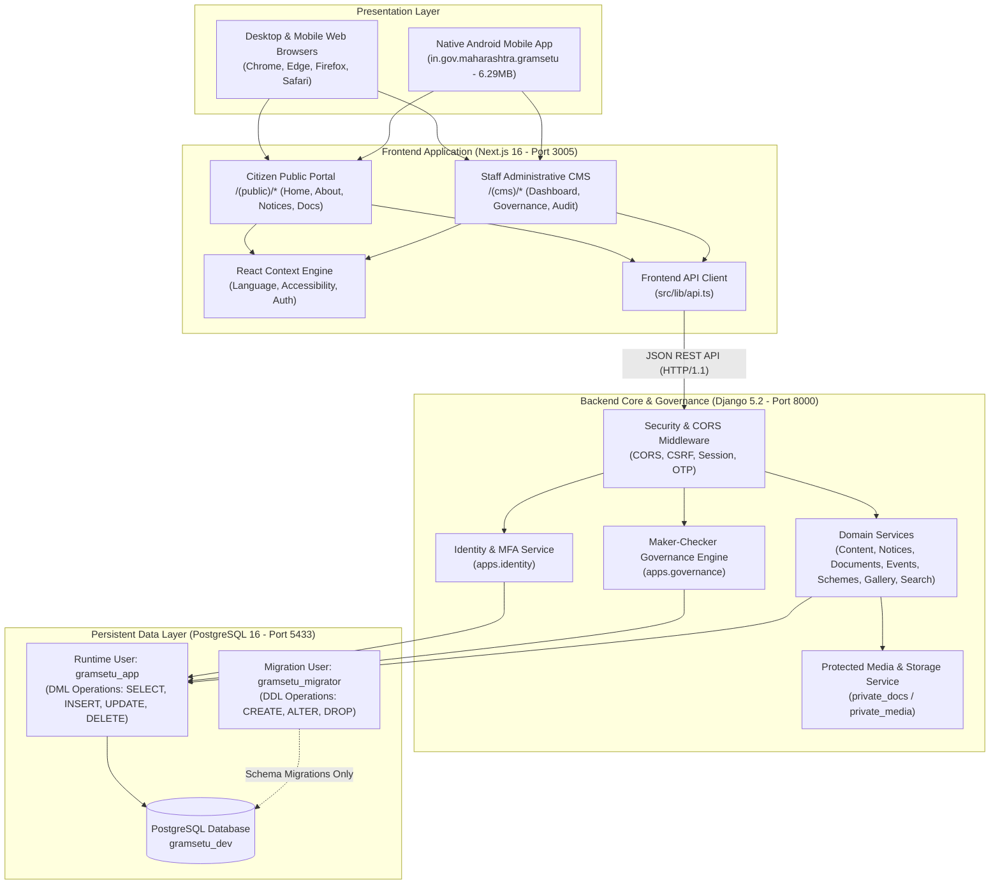
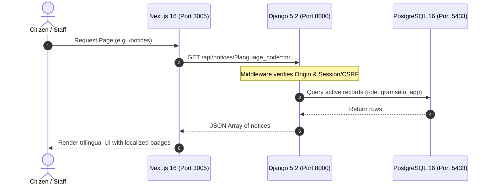

# GramSetu — System Architecture & Technical Specifications

**Project Title:** GramSetu – A Digital Gram Panchayat Information and Governance Portal  
**Anchor Village:** Narayangaon Gram Panchayat (LGD Code: `549493`, Paithan, Chhatrapati Sambhajinagar, Maharashtra)  

---

## 1. System Topology Overview

GramSetu is engineered as a decoupled, 3-tier enterprise web and mobile platform:
1. **Presentation Layer**: 
   - A reactive Next.js 16 (React 19, TypeScript, Tailwind CSS v4) application running on port `3005`, providing both the Public Citizen Portal and Staff Administrative CMS.
   - A companion native Android WebView application (`in.gov.maharashtra.gramsetu`, compiled targeting Android SDK 35) providing mobile access with offline detection, swipe-to-refresh, file upload, and download management.
2. **Business Logic & Governance Layer**: 
   - A high-integrity Python 3.11 and Django 5.2 LTS backend running on port `8000`, organized into 12 Domain Applications. It exposes REST JSON endpoints under `/api/` and executes a dual-custody Maker-Checker publishing workflow.
3. **Persistent Data Layer**: 
   - A containerized PostgreSQL 16 Alpine database binding strictly to `127.0.0.1:5433`, enforcing 4-tier least-privilege role separation between migrations, runtime application queries, test runs, and logical backups.

---

## 2. Frontend / Backend Communication & REST Architecture

All communication between the Next.js frontend and Django backend occurs over standard HTTP/1.1 REST endpoints using JSON payloads:

- **Cross-Origin Security**: Enforced via `apps.core.middleware.DeliberateCorsMiddleware`. Requests validate `Origin` against `CORS_ALLOWED_ORIGINS` (`http://localhost:3000`, `http://localhost:3005`), sending credentials (`Access-Control-Allow-Credentials: true`).
- **CSRF Protection**: All state-changing methods (`POST`, `PUT`, `DELETE`) require a valid `X-CSRFToken` header matching the `csrftoken` cookie issued by `/api/auth/csrf/`.
- **Session State**: Authenticated sessions are tracked via an encrypted `sessionid` cookie set to `HttpOnly` and `SameSite=Lax`.

---

## 3. Native Android WebView Integration

The project includes a production-ready Android application located in `android-app/`:
- **Namespace**: `in.gov.maharashtra.gramsetu`
- **Application Class**: `MainActivity.kt` (407 lines of native Kotlin)
- **Target SDK**: Android SDK 35 (Android 15), Minimum SDK 26 (Android 8.0 Oreo+)
- **Key Native Capabilities**:
  1. **Core SplashScreen**: Android 12+ `installSplashScreen()` branding.
  2. **Pull-to-Refresh**: `androidx.swiperefreshlayout:1.1.0` reloads active web views.
  3. **File Upload Chooser**: `WebChromeClient.onShowFileChooser` launches Android system file pickers via Activity Result Contracts.
  4. **Native Download Manager**: Intercepts PDF and document download links, passing them to Android's background `DownloadManager`.
  5. **Back Button Navigation**: Intercepts back gestures using `OnBackPressedCallback` to navigate WebView history before app exit.
  6. **Offline Detection**: Monitors network state via `ConnectivityManager`, rendering a native offline fallback screen with retry button when disconnected.
  7. **Security Hardening**: Disables `file://` access, enables SafeBrowsing, restricts internal navigation to `.gov.in` and loopback hosts, and dispatches external links to the system browser.
