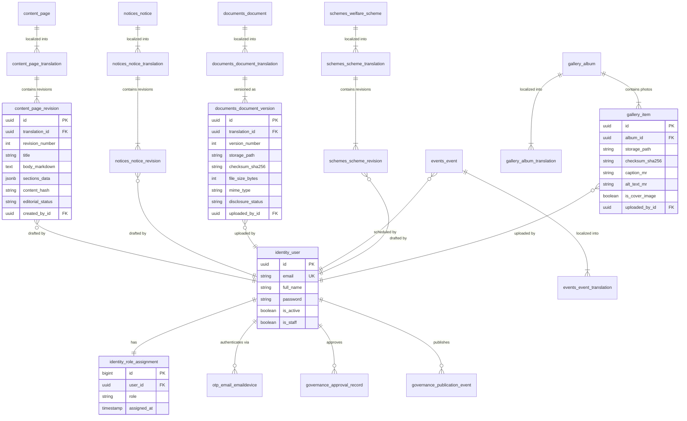

# GramSetu — Database Schema Design & ER Specifications

**Project Title:** GramSetu – A Digital Gram Panchayat Information and Governance Portal  
**Database Engine:** PostgreSQL 16 Alpine (in Docker Compose: `gramsetu-postgres`, Port 5433)  

---

## 1. Least-Privilege Role Model

GramSetu enforces enterprise least-privilege role separation across four PostgreSQL accounts:

| Role Identifier | Default Username | Granted Capabilities | Security Boundary |
|:---|:---|:---|:---|
| **Bootstrap Superuser** | `postgres` | Cluster bootstrap & role provisioning | Initialization only; unused by Django |
| **Schema Migrator** | `gramsetu_migrator` | DDL (`CREATE`, `ALTER`, `DROP TABLE`) | Schema owner; used only when running migrations (`DB_ROLE=migrator`) |
| **Runtime Application** | `gramsetu_app` | DML (`SELECT`, `INSERT`, `UPDATE`, `DELETE`) | `REVOKE CREATE ON SCHEMA public`; normal application runtime |
| **Test Runner** | `gramsetu_test_runner` | DDL & DML restricted to `gramsetu_test` | Strictly revoked from accessing development DB |
| **Backup Operator** | `gramsetu_backup` | `pg_read_all_data` | Read-only; non-locking `pg_dump` backups |

---

## 2. Entity-Relationship (ER) Diagram

---

## 3. Relational Table Inventory

The schema is distributed across 12 domain applications:

1. **`apps.identity`**:
   - `identity_user`: Custom user model with UUIDv4 primary keys and PBKDF2 password hashes.
   - `identity_role_assignment`: One-to-one relationship defining user system roles (`super_admin` vs. `operator`).
   - `identity_invitation_token`: Tracks account creation tokens with expiration.
   - `identity_operator_urgent_authorization`: Grants time-limited category-specific urgent notice authoring.
2. **`django_otp.plugins.otp_email`**:
   - `otp_email_emaildevice`: Pluggable MFA table managing 300-second, single-use Email OTP tokens.
3. **`apps.content`**:
   - `content_page`, `content_page_translation`, `content_page_revision`: Manages trilingual page revisions, content hashes, and the 14-section JSON structure (`sections_data`) for the Village Knowledge Portal.
4. **`apps.notices`**:
   - `notices_notice`, `notices_notice_translation`, `notices_notice_revision`, `notices_notice_urgent_log`: Tracks notice metadata, urgency levels, attachments, and emergency publish justifications.
5. **`apps.documents`**:
   - `documents_document`, `documents_document_translation`, `documents_document_version`: Stores document categories, reference numbers, file sizes, MIME types, and cryptographic SHA-256 hashes.
6. **`apps.events`**:
   - `events_event`, `events_event_translation`: Meeting schedules, trilingual agendas, venues, and cancellation justifications (enforcing a minimum 6-hour advance alert window).
7. **`apps.schemes`**:
   - `schemes_welfare_scheme`, `schemes_scheme_translation`, `schemes_scheme_revision`: Structured government schemes criteria, quantifiable benefits, and required document checklists.
8. **`apps.gallery`**:
   - `gallery_album`, `gallery_album_translation`, `gallery_item`: Approved photo albums, cover photo designations, single-entry captions, and SHA-256 hashes.
9. **`apps.search`**:
   - `search_document_index`: PostgreSQL `SearchVectorField` table with GIN index for full-text search.
10. **`apps.governance`**:
    - `governance_approval_record`, `governance_rejection_record`, `governance_publication_event`: Immutable non-repudiation audit ledgers.
11. **`apps.site_config`**:
    - `site_config_panchayat_profile`: Singleton table storing Narayangaon LGD code (`549493`), official contacts, and Gramsevak profile.
    - `site_config_emergency_banner`, `site_config_navigation`: Dynamic alert banners and navigation menus.
