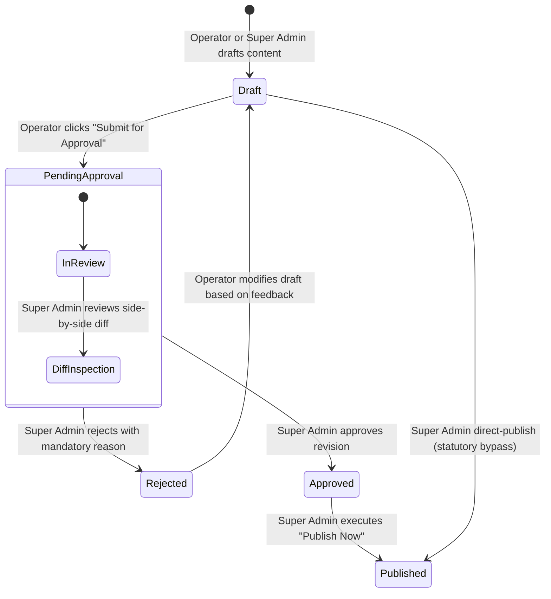

# GramSetu — Features & Functional Specifications

**Project Title:** GramSetu – A Digital Gram Panchayat Information and Governance Portal  
**Anchor Village:** Narayangaon Gram Panchayat (LGD Code: `549493`, Paithan, Chhatrapati Sambhajinagar, Maharashtra)  

---

## 1. Public Citizen Portal Features

The public portal (`/(public)/*`) provides 24/7 transparent access to village information, statutory disclosures, and government schemes:

1. **Homepage Gateway (`/`)**:
   - Official village branding with Maharashtra Rajmudra, LGD code (`549493`), and Census 2011 code (`540493`).
   - Dynamic Emergency Disaster Banner for high-priority weather/flood warnings.
   - Quick statutory cards displaying latest notices, upcoming meetings, welfare schemes, and office-holder contacts.
2. **About Panchayat / Village Knowledge Portal (`/about`)**:
   - Comprehensive Wikipedia-style rural encyclopedia in Official Light Theme.
   - Strict 3-column layout: Sticky Table of Contents (Left), Encyclopedic Article with citations (Center), and Local Governance Information card with official seal zone (Right).
   - Standardized 14 sections: Historical Background, Geographic Coordinates, Demographics, Administration, Agriculture & Water Resources, Health, Education, Connectivity, and FAQs.
3. **Notices & Announcements (`/notices`)**:
   - Proactive disclosure of statutory tenders, circulars, and general notices.
   - Urgency indicators (`Urgent` vs `Normal`) and automatic filtering between active and expired notices.
   - Downloadable PDF attachments with file size indicators.
4. **Disclosed Documents & Orders (`/documents`)**:
   - RTI Section 4(1)(b) proactive disclosure repository for gazettes, budgets, and meeting resolutions.
   - Secure streaming downloads verified against cryptographic SHA-256 hashes.
5. **Meetings & Events Calendar (`/events`)**:
   - Statutory Gram Sabha calendar with venue, time, and agenda items.
   - Mandatory minimum 6-hour advance Cancellation Banner displaying formal cancellation justifications.
6. **Welfare Schemes Directory (`/schemes` & `/schemes/[slug]`)**:
   - Categorized Central and State government schemes with filtering by target beneficiary (Farmers, Women, Students, BPL).
   - Dedicated detail pages breaking down Eligibility Criteria, Quantifiable Benefits, Required Documents Checklist, Application Workflows, and official government portal links.
7. **Village Photo Gallery (`/gallery`)**:
   - Responsive 3-column photo gallery of approved village development projects.
   - Interactive Lightbox with keyboard navigation (`Escape`, `ArrowLeft`, `ArrowRight`).
   - Clean single-entry captioning in the album's primary language.
8. **Unified Public Search (`/search`)**:
   - Full-text search engine querying across all published notices, documents, schemes, and knowledge articles.

---

## 2. Administrative Staff CMS Features

The administrative CMS (`/(cms)/*`) provides secure content authoring, review, and publishing workflows:

1. **Two-Factor Authentication Login Gate (`/cms`)**:
   - Email and PBKDF2 password authentication followed by a single-use 6-digit Email OTP challenge.
   - Brute-force protection: 5 consecutive failed attempts trigger a 15-minute account lock.
2. **Main Operational Dashboard (`/cms`)**:
   - Overview metrics displaying pending approval counts, draft counts, and quick actions tailored by role.
3. **Dual-Custody Governance Review Queue (`/cms/governance`)**:
   - Maker-Checker review queue listing all pending drafts.
   - Side-by-side Revision Diff Inspector allowing the Super Admin to inspect exact textual changes before approving.
   - Action engine supporting `approve`, `reject` (with mandatory justification), and direct `publish`.
4. **Village Knowledge Editor (`/cms/content`)**:
   - Section-by-section JSON structured editor for updating the 14 sections of the Village Encyclopedia.
5. **Notices & Document Managers (`/cms/notices`, `/cms/documents`)**:
   - Notice authoring with urgency tags and expiry dates.
   - Multi-version document upload engine automatically calculating byte sizes, MIME types, and SHA-256 hashes.
6. **Events & Schemes Managers (`/cms/events`, `/cms/schemes`)**:
   - Meeting scheduler with mandatory 6-hour cancellation warning workflow.
   - Welfare scheme criteria and benefits management.
7. **Photo Gallery Manager (`/cms/gallery`)**:
   - Album creation and photo upload manager with cover photo designation.
8. **Panchayat Profile Manager (`/cms/profile`)**:
   - Office-holder management: Gramsevak (**ASHOK GANPAT WALE** / **अशोक गणपत वाले**), Sarpanch display, and official seal zone settings.
9. **Immutable Governance Audit Ledger (`/cms/audit`)**:
   - Non-repudiation log tracking timestamped approval, rejection, and publication events with actor IDs and revision hashes.

---

## 3. Multilingual Support & Accessibility (GIGW 3.0 & WCAG 2.2 AA)

- **Trilingual Architecture**: Statutory default in Marathi (`mr`), with instant runtime toggling to Hindi (`hi`) and English (`en`) via `LanguageContext`.
- **High-Contrast Theme**: Meets WCAG 2.2 AA contrast ratios (> 7:1) using a dark/high-contrast palette for low-vision users.
- **Tri-Level Text Scaling**: Resizes text across `normal` (100%), `large` (110%), and `xlarge` (120%) using root `rem` scaling.
- **Skip Links & Landmarks**: Provides skip-to-content links and HTML5 semantic landmarks (`<header>`, `<nav>`, `<main>`, `<article>`, `<footer>`) for screen readers.

---

## 4. Maker-Checker Dual-Custody Governance Workflow

- **Operator (Maker)**: Drafts and submits revisions. Cannot approve their own submissions (`is_self_approval` check blocks operator approvals).
- **Super Admin / Gramsevak (Checker)**: Has statutory authority to approve, reject with justification, or publish directly.
- **Sarpanch**: By democratic constitutional design, holds **no technical login account**, preserving official records from partisan tampering.

---

## 5. Future Scope

The following capabilities are planned for future development milestones and are not currently implemented:

- **Android Mobile Application**: Development of a dedicated Android mobile application to extend GramSetu's accessibility to smartphone users.
- **Citizen Property & Water Tax Gateway**: State treasury banking integration (Maharashtra e-Gras).
- **Automated WhatsApp / SMS Gateway**: Push notifications for statutory Gram Sabha summons and urgent disaster alerts.

