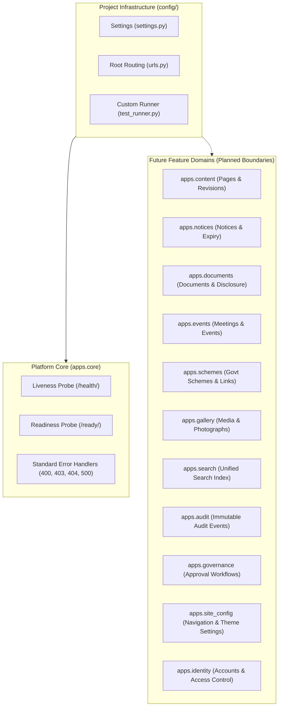

# GramSetu — Application Architecture & Conventions

This document establishes the internal Django application architecture, configuration conventions, module boundaries, and operational standards for **GramSetu**, an official Gram Panchayat information portal in Maharashtra, India.

---

## 1. Architectural Overview & Domain Separation

GramSetu is structured as a **modular Django monolith**, separating project-level infrastructure configuration from domain-specific business applications.



---

## 2. Directory Structure

```
C:\dev\GramSetu\
├── .git/                                   # Initialized Git repository
├── .gitattributes                          # Enforces LF line endings for shell scripts
├── .gitignore                              # Comprehensive exclusions (.venv, .env, backups, etc.)
├── .env                                    # Local secrets (UNTRACKED / GITIGNORED)
├── .env.example                            # Public template with placeholder values
├── README.md                               # Operational manual and runbook
├── docker-compose.yml                      # Dedicated PostgreSQL 16 service
├── manage.py                               # Django CLI entrypoint
├── requirements.txt                        # Pinned dependencies (Django 5.2 LTS, psycopg2, python-dotenv)
├── .venv/                                  # Virtual environment (GITIGNORED)
├── backups/                                # Local backup directory (GITIGNORED)
├── config/                                 # Project configuration package
│   ├── __init__.py
│   ├── asgi.py
│   ├── settings.py                         # Environment-driven settings & role routing
│   ├── test_runner.py                      # Database isolation test runner
│   ├── tests.py                            # Foundation smoke & security tests
│   ├── urls.py                             # Root URLconf delegating to core & admin
│   └── wsgi.py
├── apps/                                   # Domain applications package
│   ├── __init__.py
│   ├── core/                               # Core infrastructure, health probes, utilities
│   │   ├── __init__.py
│   │   ├── apps.py                         # CoreConfig ('apps.core')
│   │   ├── utils.py                        # RFC 9562 UUIDv7 generator
│   │   ├── views.py                        # Health, readiness, error handlers
│   │   ├── urls.py                         # Infrastructure routing (/health/, /ready/)
│   │   └── tests.py                        # Architectural & operational unit tests
│   ├── content/                            # Future informational content & revisions
│   ├── notices/                            # Future announcements, notices, expiry
│   ├── documents/                          # Future document metadata & disclosure
│   ├── events/                             # Future meetings & events
│   ├── schemes/                            # Future welfare schemes & official links
│   ├── gallery/                            # Future approved media & photographs
│   ├── search/                             # Future unified search across public data
│   ├── audit/                              # Future immutable audit trail
│   ├── governance/                         # Future approval states & publication workflows
│   ├── site_config/                        # Site configuration, singleton profile, emergency banners
│   │   ├── migrations/                     # 0001_initial (PanchayatProfile, SiteNavigation, EmergencyBanner)
│   │   ├── models.py                       # Singleton PanchayatProfile, multilingual nav & banners
│   │   └── tests.py                        # Site configuration unit tests
│   └── identity/                           # User identity, RBAC, invitations, urgent authorizations
│       ├── migrations/                     # 0001_initial (User, RoleAssignment, InvitationToken, OperatorUrgentAuthorization)
│       ├── models.py                       # Custom User (UUIDv7, email username), RBAC, tokens
│       └── tests.py                        # Identity unit tests
├── docker/
│   └── init-db/
│       └── 01-init-databases-and-roles.sh  # PostgreSQL container initialization
├── docs/
│   ├── architecture.md                     # This document
│   ├── data-model.md                       # Data model & publishing workflow design specification
│   └── decisions/                          # Architecture Decision Records (ADRs 0001-0006)
│       ├── 0001-multilingual-content-representation.md
│       ├── 0002-immutable-revisions-and-approvals.md
│       ├── 0003-publication-history-and-rollback.md
│       ├── 0004-document-versioning-and-disclosure-approval.md
│       ├── 0005-audit-record-immutability-and-protection.md
│       └── 0006-integrity-guarantees-database-vs-application.md
└── scripts/
    └── backup.py                           # Verified logical backup utility
```

---

## 3. Domain Module Responsibilities & Implementation Status

> [!IMPORTANT]
> **Data Model & Publishing Workflow Design Specification:**  
> A comprehensive, implementation-ready domain model and governance specification is established in [`docs/data-model.md`](data-model.md) alongside the Architecture Decision Records in [`docs/decisions/`](decisions/).  
> **Milestone 4A Status:** Foundational identity and site configuration models have been implemented in `apps/identity` and `apps/site_config` with initial migrations and unit tests. Pending explicit authorization to remediate pre-existing empty auth migrations in `gramsetu_dev`, these migrations are staged and unapplied to the active database. The remaining domain apps remain clean architectural skeletons.

| App Module | Package Name | Verbose Name (Bilingual) | Current Implementation Status | Future Planned Responsibility |
| :--- | :--- | :--- | :--- | :--- |
| **`core`** | `apps.core` | Core / मुख्य | **Implemented** (Probes, Error Views, UUIDv7 Utils, Tests) | Shared utilities, health/readiness endpoints, baseline error handlers, base templates. |
| **`content`** | `apps.content` | Content / मजकूर | **Skeleton Only** (`AppConfig`) | Public informational pages (About Panchayat, Village Profile, History), rich-text revisions. |
| **`notices`** | `apps.notices` | Notices / सूचना | **Skeleton Only** (`AppConfig`) | Official announcements, tender notices, statutory notices, publication and expiry dates. |
| **`documents`** | `apps.documents` | Documents / कागदपत्रे | **Skeleton Only** (`AppConfig`) | Document metadata, meeting minutes, resolution PDFs, disclosure controls. |
| **`events`** | `apps.events` | Events / कार्यक्रम | **Skeleton Only** (`AppConfig`) | Gram Sabha meetings, health camps, administrative hearings, public calendars. |
| **`schemes`** | `apps.schemes` | Schemes / योजना | **Skeleton Only** (`AppConfig`) | State/Central government welfare schemes, eligibility criteria, application links. |
| **`gallery`** | `apps.gallery` | Gallery / चित्रदालन | **Skeleton Only** (`AppConfig`) | Village development photographs, cultural events, approved media metadata. |
| **`search`** | `apps.search` | Search / शोध | **Skeleton Only** (`AppConfig`) | Unified search indexing across notices, schemes, resolutions, and pages. |
| **`audit`** | `apps.audit` | Audit / लेखापरीक्षण | **Skeleton Only** (`AppConfig`) | Immutable recording of administrative actions (logins, uploads, approvals, status changes). |
| **`governance`**| `apps.governance` | Governance / शासन | **Skeleton Only** (`AppConfig`) | Publication state machine (`draft` -> `pending_approval` -> `published`), sign-offs. |
| **`site_config`**| `apps.site_config` | Site Configuration / संकेतस्थळ संरचना | **Implemented** (Milestone 4A: Models, Migrations, Tests) | Header/footer navigation, theme toggle, emergency banners, official contacts. |
| **`identity`** | `apps.identity` | Identity / ओळख | **Implemented** (Milestone 4A: Models, Migrations, Tests) | Invitation-only CMS user accounts, email OTP MFA, operator permissions. |

---

## 4. Health and Readiness Probe Architecture

To support containerized lifecycle management, process monitoring, and safe load balancing, `apps.core` exposes two dedicated endpoints:

### 4.1 Process Liveness Probe (`/health/`)
- **Path:** `/health/` (`core:health`)
- **Purpose:** Indicates whether the Django WSGI/ASGI application process is alive and receiving traffic.
- **Behavior:** Does **not** touch external dependencies (database, cache, or filesystem).
- **HTTP Methods:** Allowed: `GET`, `HEAD`. Disallowed: `POST`, `PUT`, `DELETE` (returns `405 Method Not Allowed`).
- **Response Format:**
  ```json
  {
    "status": "ok",
    "service": "gramsetu"
  }
  ```
- **Status Code:** `200 OK`

### 4.2 Service Readiness Probe (`/ready/`)
- **Path:** `/ready/` (`core:ready`)
- **Purpose:** Checks whether the application process can successfully execute a heartbeat query against its configured PostgreSQL database.
- **Behavior:** Executes a lightweight non-locking query: `SELECT 1;`.
- **HTTP Methods:** Allowed: `GET`, `HEAD`. Disallowed: `POST`, `PUT`, `DELETE` (returns `405 Method Not Allowed`).
- **Success Response (`200 OK`):**
  ```json
  {
    "status": "ready",
    "database": "connected"
  }
  ```
- **Failure Response (`503 Service Unavailable`):**
  ```json
  {
    "status": "unready",
    "database": "unavailable"
  }
  ```
- **Information Leakage Prevention:** On connection or query failure, technical error messages, database credentials, host paths, and SQL queries are **never** returned to the caller. The technical exception is logged internally via `logger.error()`.

---

## 5. Configuration & Environment Security Conventions

### 5.1 Strict Role-Based Database Connection Logic
To guarantee least privilege and prevent accidental privilege escalation, database access is dynamically selected based on operational context:

```python
IS_TESTING = 'test' in sys.argv or os.getenv('APP_ENV') == 'test'
DB_ROLE = os.getenv('DB_ROLE', 'app').lower()
```

1. **Test Mode (`IS_TESTING = True`):**
   - Automatically connects to `gramsetu_test` using `TEST_DB_USER` (`gramsetu_test_runner`).
   - Blocked by PostgreSQL permissions from connecting to `gramsetu_dev`.
2. **Migration Mode (`DB_ROLE = 'migrator'`):**
   - Explicitly invoked for schema migrations: `DB_ROLE=migrator python manage.py migrate`.
   - Connects to `gramsetu_dev` using `MIGRATOR_DB_USER` (`gramsetu_migrator`), the schema owner.
3. **Application Runtime Mode (`DB_ROLE = 'app'`):**
   - Standard runtime for web requests.
   - Connects to `gramsetu_dev` using `APP_DB_USER` (`gramsetu_app`), which holds **DML-only** rights (`SELECT`, `INSERT`, `UPDATE`, `DELETE`) and is explicitly denied `CREATE` privileges on schema `public`.
4. **Invalid Role Enforcement:**
   - Any unknown `DB_ROLE` (e.g. `DB_ROLE=admin`) raises an immediate, non-ignorable `RuntimeError` on startup, preventing silent fallbacks.

### 5.2 Secret Isolation
- All secrets reside strictly in `.env` (gitignored).
- The template `.env.example` contains only descriptive placeholder strings.
- In production configurations, `DEBUG = False` is enforced, preventing standard Django tracebacks from exposing code or environment variables.

---

## 6. Logging Conventions

GramSetu establishes a structured, console-friendly logging configuration via Python's standard `logging` library:
- **Formatters:**
  - `verbose`: `[{asctime}] {levelname} [{name}:{lineno}] {message}` (active when `DEBUG=True`).
  - `simple`: `{levelname} {name}: {message}` (active when `DEBUG=False`).
- **Loggers:**
  - `gramsetu`: Application-level operational logger (`apps.core`, etc.).
  - `django.security`: Captures CSRF failures, suspicious operations, and host header tampering.
  - `django`: Captures standard framework warnings and errors.
- **Redaction Rules:**
  - Passwords, secret keys, OTPs, session cookies, and authorization headers must **never** be logged.
  - Operational application logging is strictly separated from the future immutable audit-event system (`apps.audit`).

---

## 7. URL Organization & Namespacing

- **Root Routing (`config/urls.py`):**
  - Infrastructure probes are mounted at the root (`path('', include('apps.core.urls'))`).
  - Future public apps will use clean, human-readable URLs with standard Django namespacing (e.g., `notices:list`, `documents:detail`).
- **Error Handlers:**
  - Custom views in `apps.core.views` handle `400`, `403`, `404`, and `500` without rendering sensitive debug pages when `DEBUG=False`.

---

## 8. Automated Testing Strategy

Automated tests are divided into two distinct suites:
1. **Foundation Tests (`config/tests.py`):**
   - Verifies core settings loading and Marathi localization.
   - Verifies active database connection is strictly `gramsetu_test`.
   - Verifies active role is `gramsetu_test_runner`.
   - Verifies negative database isolation: `gramsetu_test_runner` cannot connect to `gramsetu_dev`.
   - Verifies destructive operations (`CREATE TABLE`, `TRUNCATE`, `DROP TABLE`) executed in test runs are completely isolated from `gramsetu_dev`.
2. **Core Architectural Tests (`apps/core/tests.py`):**
   - Verifies all 12 domain apps are registered in Django's app registry.
   - Verifies `/health/` returns 200 with minimal JSON and enforces HTTP method restrictions (GET/HEAD allowed, POST/DELETE rejected with 405).
   - Verifies `/ready/` returns 200 on healthy database and 503 on mocked database disconnection without leaking technical exception strings.
   - Verifies no secret keys, database credentials, or host paths are present in probe responses.
   - Verifies URL namespacing (`core:health`, `core:ready`).
   - Verifies error handler views (400, 403, 404, 500).
   - Verifies `LOGGING` dictionary structure and invalid `DB_ROLE` rejection.

### Running Tests
```powershell
python manage.py test
```
*Note: All 17 tests execute against `gramsetu_test` with `keepdb=True` in under 0.5 seconds.*
