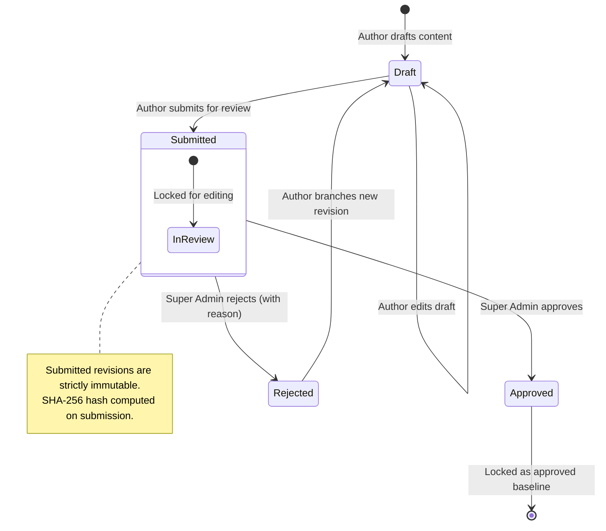
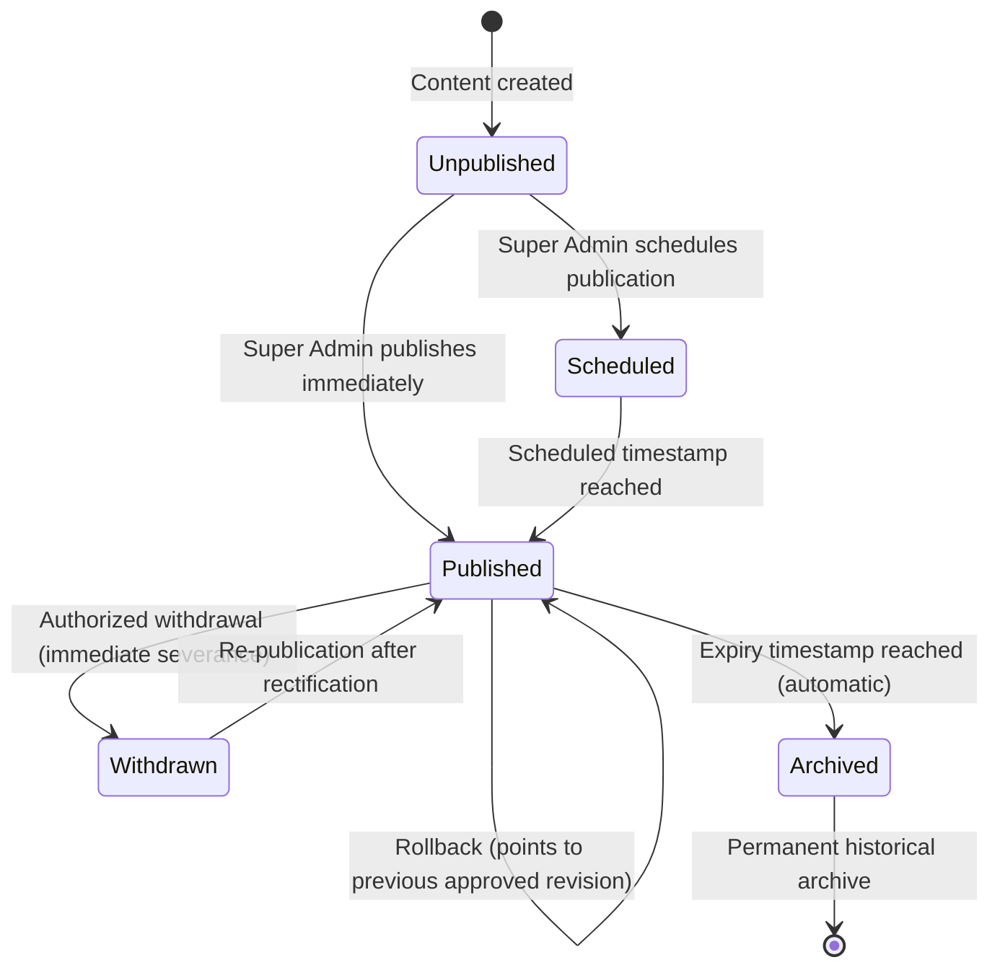
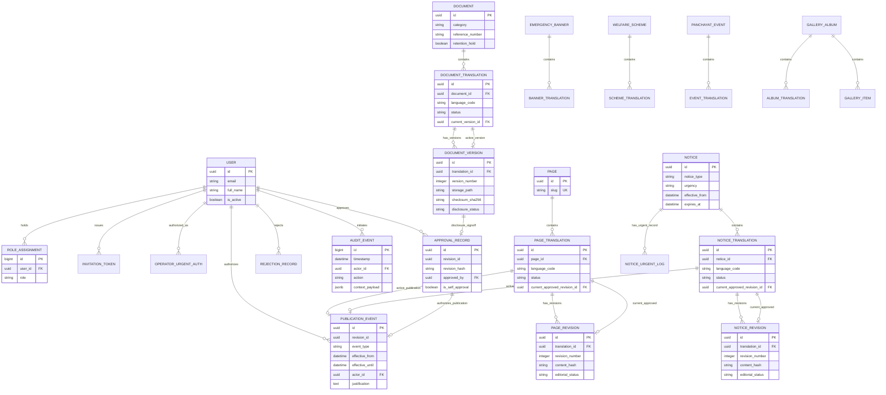

# GramSetu — Data Model & Publishing Workflow Specification

> **Architectural Specification — Milestone 3 Design Document**  
> *Target System:* Django 5.2 LTS Monolith with PostgreSQL 16 on Docker  
> *Domain Context:* Official Gram Panchayat Information Portal (Maharashtra, India)  
> *Status:* Reviewed & Approved Design Specification (Not an implemented database schema)

---

## Table of Contents
1. [Domain Overview & Architecture Principles](#1-domain-overview--architecture-principles)
2. [Multilingual Content Architecture](#2-multilingual-content-architecture)
3. [Editorial Revision & Governance State Machines](#3-editorial-revision--governance-state-machines)
4. [Domain Entity Specifications](#4-domain-entity-specifications)
   - 4.1 [Identity & Access Control (`apps.identity`)](#41-identity--access-control-appsidentity)
   - 4.2 [Site Configuration & Panchayat Profile (`apps.site_config`)](#42-site-configuration--panchayat-profile-appssite_config)
   - 4.3 [Governance & Approval Workflows (`apps.governance`)](#43-governance--approval-workflows-appsgovernance)
   - 4.4 [Informational Content (`apps.content`)](#44-informational-content-appscontent)
   - 4.5 [Notices & Announcements (`apps.notices`)](#45-notices--announcements-appsnotices)
   - 4.6 [Documents & Disclosure Control (`apps.documents`)](#46-documents--disclosure-control-appsdocuments)
   - 4.7 [Panchayat Events & Meetings (`apps.events`)](#47-panchayat-events--meetings-appsevents)
   - 4.8 [Welfare Schemes & Public Links (`apps.schemes`)](#48-welfare-schemes--public-links-appsschemes)
   - 4.9 [Approved Media Gallery (`apps.gallery`)](#49-approved-media-gallery-appsgallery)
   - 4.10 [Unified Public Search Index (`apps.search`)](#410-unified-public-search-index-appssearch)
   - 4.11 [Immutable Audit Logging (`apps.audit`)](#411-immutable-audit-logging-appsaudit)
5. [Entity-Relationship Diagram (ERD)](#5-entity-relationship-diagram-erd)
6. [Notice Lifecycle & Urgent Publication Workflow](#6-notice-lifecycle--urgent-publication-workflow)
7. [Document Versioning, Storage, & Disclosure Architecture](#7-document-versioning-storage--disclosure-architecture)
8. [PostgreSQL Integrity Constraints & Indexing Strategy](#8-postgresql-integrity-constraints--indexing-strategy)
9. [Concurrency Controls & Transaction Safeguards](#9-concurrency-controls--transaction-safeguards)
10. [Data Retention, Archival, & Deletion Policies](#10-data-retention-archival--deletion-policies)
11. [MVP vs. Deferred Entities](#11-mvp-vs-deferred-entities)
12. [Assumptions, Risks, & Open Architectural Questions](#12-assumptions-risks--open-architectural-questions)

---

## 1. Domain Overview & Architecture Principles

GramSetu is the official e-governance information portal for a Gram Panchayat in Maharashtra, India. It operates under the statutory provisions of the Maharashtra Village Panchayats Act and guidelines of the Ministry of Panchayati Raj.

### 1.1 Core Architectural Principles
1. **Official Record Authenticity:** Content published on the portal carries administrative authority. Revisions, approvals, rollbacks, and emergency releases must have verifiable, unalterable provenance.
2. **Marathi-First Multilingual Design:** Marathi (`mr`) is the primary statutory language and default locale. Hindi (`hi`) and English (`en`) are supported secondary languages. Translations are modeled as independent relational entities with independent lifecycles.
3. **Immutability of Submitted Revisions:** Once submitted for review or approved, editorial content cannot be edited in place. Any modification creates a new draft revision.
4. **Stable Public Availability:** A currently published revision remains live and accessible while replacement drafts undergo review and approval.
5. **Private by Default for Documents:** All uploaded binary files are private upon ingestion. Public access requires an explicit disclosure approval action by a Super Administrator. Files are protected from URL guessing through unguessable storage keys and reverse-proxy streaming views.
6. **Defense in Depth Integrity:** PostgreSQL database constraints (`CHECK`, `UNIQUE`, partial indexes, foreign keys, triggers) enforce fundamental invariants, ensuring data consistency even if application logic is bypassed or encounters race conditions.

---

## 2. Multilingual Content Architecture

### 2.1 The Explicit Translation Entity Pattern
Rather than storing multilingual fields in serialized JSON columns or wide horizontal tables (`title_mr`, `title_hi`), GramSetu implements the **Explicit Translation Entity** pattern (Translation by Row) across all translatable domains.

```
[ Logical Entity (e.g., Notice) ]
  ├── [ Translation Row (mr) ] ──► [ Revision History (v1, v2, v3) ] ──► Status: Published
  ├── [ Translation Row (hi) ] ──► [ Revision History (v1) ]         ──► Status: Pending Review
  └── [ Translation Row (en) ] ──► (No record or Draft)             ──► Status: Unpublished
```

### 2.2 Independent Governance per Language
- **Independent Approval:** An administrator may approve and publish a Marathi notice immediately upon drafting. The Hindi translation can be drafted, reviewed, and published days later without modifying the Marathi record.
- **Independent Rollback & Withdrawal:** Withdrawing an English translation due to a translation inaccuracy leaves the official Marathi publication active.
- **Devanagari Unicode & Collation:** All text columns use PostgreSQL UTF-8 character encoding with Devanagari Unicode support. Slugs support Devanagari script via Django `allow_unicode=True`. Collation for Marathi sorting is specified as `COLLATE "mr-IN-x-icu"` where alphabetical Devanagari sorting is required.

### 2.3 Citizen Fallback & Availability Signaling
- When a citizen requests an English URL (e.g., `/en/notices/gram-sabha-oct-2026/`) and no approved English translation exists, the system does **not** leak unapproved drafts or emit a generic 404/500 error.
- The view dynamically renders the approved default Marathi content accompanied by a clear, accessible banner:
  > *सूचना: ही माहिती अद्याप इंग्रजीमध्ये उपलब्ध नाही. अधिकृत मराठी आवृत्ती दर्शविली जात आहे.*  
  > *(Notice: This information is not yet available in English. Displaying the official Marathi version.)*
- Navigation menus and language switchers evaluate translation publication status dynamically, marking available languages clearly.

---

## 3. Editorial Revision & Governance State Machines

GramSetu enforces a strict separation between **Editorial Revision Status** (the draft/review lifecycle) and **Public Availability Status** (citizen-facing visibility).

### 3.1 Editorial Revision State Machine
Every revision row progresses through the following deterministic states:



### 3.2 Public Publication Lifecycle State Machine
Independent of authoring, public exposure follows an explicit lifecycle governed by `apps.governance.PublicationEvent`:



---

## 4. Domain Entity Specifications

### 4.1 Identity & Access Control (`apps.identity`)

GramSetu operates strictly on an **invitation-only** administrative model with two fixed roles. Ordinary citizens have read-only access to public pages and do not hold user accounts.

#### `User`
Custom user model replacing default Django user, using verified email as unique username.
- **Table Name:** `identity_user`
- **Primary Key:** `UUIDv7`
- **Fields:**
  - `id`: `UUIDField(primary_key=True, default=uuid7, editable=False)`
  - `email`: `EmailField(unique=True, db_index=True)`
  - `full_name`: `CharField(max_length=255)`
  - `phone_number`: `CharField(max_length=15, blank=True)`
  - `is_active`: `BooleanField(default=True)`
  - `is_staff`: `BooleanField(default=True)` (Required for CMS administrative access)
  - `is_superuser`: `BooleanField(default=False)` (Reserved strictly for CLI emergency recovery; normal operations use Super Admin role)
  - `date_joined`: `DateTimeField(auto_now_add=True)`
  - `last_login`: `DateTimeField(null=True, blank=True)`
- **Constraints & Indexes:**
  - `CONSTRAINT check_email_lowercase CHECK (email = LOWER(email))`
  - Index on `(is_active, email)`

#### `RoleAssignment`
Maps administrative users to one of the two authorized system roles.
- **Table Name:** `identity_role_assignment`
- **Fields:**
  - `id`: `BigAutoField(primary_key=True)`
  - `user`: `OneToOneField(User, on_delete=CASCADE, related_name='role_assignment')`
  - `role`: `CharField(max_length=20, choices=[('super_admin', 'Super Administrator'), ('operator', 'Operator')])`
  - `assigned_by`: `ForeignKey(User, on_delete=PROTECT, related_name='granted_roles')`
  - `assigned_at`: `DateTimeField(auto_now_add=True)`
- **Constraints:**
  - `CONSTRAINT valid_role CHECK (role IN ('super_admin', 'operator'))`

#### `InvitationToken`
Time-limited, single-use cryptographically random invitation tokens generated by Super Administrators to onboard new staff.
- **Table Name:** `identity_invitation_token`
- **Fields:**
  - `id`: `UUIDv7`
  - `email`: `EmailField()`
  - `target_role`: `CharField(max_length=20, choices=[('super_admin', 'Super Administrator'), ('operator', 'Operator')])`
  - `token_hash`: `CharField(max_length=64, unique=True)` (SHA-256 hash of plaintext invitation URL token)
  - `invited_by`: `ForeignKey(User, on_delete=PROTECT)`
  - `created_at`: `DateTimeField(auto_now_add=True)`
  - `expires_at`: `DateTimeField()` (Default: 48 hours from issuance)
  - `used_at`: `DateTimeField(null=True, blank=True)`
  - `is_revoked`: `BooleanField(default=False)`
- **Constraints:**
  - `CONSTRAINT check_token_validity CHECK (expires_at > created_at)`

#### `OperatorUrgentAuthorization`
Granular authority granted by a Super Administrator allowing an Operator to publish urgent notices without prior review for designated disaster or public safety categories.
- **Table Name:** `identity_operator_urgent_authorization`
- **Fields:**
  - `id`: `BigAutoField(primary_key=True)`
  - `operator`: `ForeignKey(User, on_delete=CASCADE, related_name='urgent_authorizations')`
  - `authorized_by`: `ForeignKey(User, on_delete=PROTECT, related_name='granted_urgent_authorizations')`
  - `allowed_category`: `CharField(max_length=50, choices=[('disaster_alert', 'Disaster Alert'), ('public_health', 'Public Health Emergency'), ('water_supply', 'Critical Water Alert'), ('weather_warning', 'Severe Weather Warning')])`
  - `valid_from`: `DateTimeField()`
  - `valid_to`: `DateTimeField()`
  - `is_revoked`: `BooleanField(default=False)`
  - `created_at`: `DateTimeField(auto_now_add=True)`
- **Constraints:**
  - `CONSTRAINT check_auth_dates CHECK (valid_to > valid_from)`
  - Partial Unique Index: `UNIQUE (operator, allowed_category) WHERE (is_revoked = FALSE)`

---

### 4.2 Site Configuration & Panchayat Profile (`apps.site_config`)

#### `PanchayatProfile`
Singleton record containing statutory identity information for the local Gram Panchayat.
- **Table Name:** `site_config_panchayat_profile`
- **Fields:**
  - `id`: `SmallIntegerField(primary_key=True, default=1)` (Enforces singleton via `CHECK (id = 1)`)
  - `census_code`: `CharField(max_length=20, unique=True)` (Official Census 2011 village code)
  - `lgd_code`: `CharField(max_length=20, unique=True)` (Local Government Directory code)
  - `district_name_mr`: `CharField(max_length=100)`
  - `district_name_en`: `CharField(max_length=100)`
  - `taluka_name_mr`: `CharField(max_length=100)`
  - `taluka_name_en`: `CharField(max_length=100)`
  - `panchayat_name_mr`: `CharField(max_length=200)`
  - `panchayat_name_en`: `CharField(max_length=200)`
  - `office_address_mr`: `TextField()`
  - `office_address_en`: `TextField()`
  - `contact_email`: `EmailField()`
  - `contact_phone`: `CharField(max_length=20)`
  - `sarpanch_name`: `CharField(max_length=150)`
  - `gram_sevak_name`: `CharField(max_length=150)`
  - `official_seal_asset_path`: `CharField(max_length=500, blank=True)`
  - `show_archived_notices_publicly`: `BooleanField(default=True)` (Controls public visibility of expired notices)
  - `updated_at`: `DateTimeField(auto_now=True)`
  - `updated_by`: `ForeignKey(User, on_delete=PROTECT)`

#### `EmergencyBanner`
High-visibility emergency alert broadcast across all public pages (e.g. flood warning, cholera alert).
- **Table Name:** `site_config_emergency_banner`
- **Fields:**
  - `id`: `BigAutoField(primary_key=True)`
  - `severity`: `CharField(max_length=20, choices=[('info', 'Informational'), ('warning', 'Warning'), ('danger', 'Critical Emergency')])`
  - `is_active`: `BooleanField(default=False)`
  - `activated_at`: `DateTimeField(null=True, blank=True)`
  - `deactivated_at`: `DateTimeField(null=True, blank=True)`
  - `created_by`: `ForeignKey(User, on_delete=PROTECT)`
- **Constraints:**
  - **Partial Unique Index:** `CREATE UNIQUE INDEX uq_active_banner ON site_config_emergency_banner (is_active) WHERE (is_active = TRUE);` (Guarantees only one emergency banner can be active site-wide at any moment).

#### `EmergencyBannerTranslation`
Multilingual copy for the emergency banner.
- **Table Name:** `site_config_emergency_banner_translation`
- **Fields:**
  - `id`: `BigAutoField(primary_key=True)`
  - `banner`: `ForeignKey(EmergencyBanner, on_delete=CASCADE, related_name='translations')`
  - `language_code`: `CharField(max_length=5, choices=[('mr', 'Marathi'), ('hi', 'Hindi'), ('en', 'English')])`
  - `message`: `CharField(max_length=500)`
  - `action_url`: `URLField(blank=True)`
  - `action_label`: `CharField(max_length=100, blank=True)`
- **Constraints:**
  - `UNIQUE (banner, language_code)`
  - `CONSTRAINT valid_banner_lang CHECK (language_code IN ('mr', 'hi', 'en'))`

---

### 4.3 Governance & Approval Workflows (`apps.governance`)

This application serves as the authoritative audit ledger for all editorial approvals, rejections, publications, withdrawals, and rollbacks across all content apps.

#### `ApprovalRecord`
Formal sign-off by a Super Administrator binding to an exact, immutable content revision.
- **Table Name:** `governance_approval_record`
- **Fields:**
  - `id`: `UUIDv7`
  - `target_content_type`: `CharField(max_length=100)` (e.g., `noticetranslation`, `pagetranslation`, `documentversion`)
  - `target_id`: `UUIDField()`
  - `revision_id`: `UUIDField()` (Foreign pointer to the specific approved revision row)
  - `revision_hash`: `CharField(max_length=64)` (SHA-256 hash verified against revision payload at approval time)
  - `approved_by`: `ForeignKey(User, on_delete=PROTECT, related_name='approved_records')`
  - `approved_at`: `DateTimeField(auto_now_add=True)`
  - `notes`: `TextField(blank=True)`
  - `is_self_approval`: `BooleanField(default=False)` (Flagged `True` if author == approver)

#### `RejectionRecord`
Mandatory administrative record when a submitted revision is rejected by a Super Administrator.
- **Table Name:** `governance_rejection_record`
- **Fields:**
  - `id`: `UUIDv7`
  - `target_content_type`: `CharField(max_length=100)`
  - `target_id`: `UUIDField()`
  - `revision_id`: `UUIDField()`
  - `rejected_by`: `ForeignKey(User, on_delete=PROTECT)`
  - `rejected_at`: `DateTimeField(auto_now_add=True)`
  - `rejection_reason`: `TextField()` (Mandatory rationale for why content was rejected)
- **Constraints:**
  - `CONSTRAINT check_rejection_reason CHECK (LENGTH(TRIM(rejection_reason)) >= 10)`

#### `PublicationEvent`
Append-only historical ledger capturing every change in public visibility.
- **Table Name:** `governance_publication_event`
- **Fields:**
  - `id`: `UUIDv7`
  - `target_content_type`: `CharField(max_length=100)`
  - `target_id`: `UUIDField()`
  - `revision_id`: `UUIDField()` (The revision made live by this event)
  - `event_type`: `CharField(max_length=30, choices=[('initial_publish', 'Initial Publication'), ('update_publish', 'Update Publication'), ('scheduled_publish', 'Scheduled Publication'), ('urgent_publish', 'Urgent Publication Bypass'), ('rollback', 'Rollback to Previous Revision'), ('withdrawal', 'Administrative Withdrawal'), ('archival', 'Automatic Expiry Archival')])`
  - `scheduled_for`: `DateTimeField(null=True, blank=True)`
  - `effective_from`: `DateTimeField(default=timezone.now)`
  - `effective_until`: `DateTimeField(null=True, blank=True)`
  - `actor`: `ForeignKey(User, on_delete=PROTECT)`
  - `justification`: `TextField(blank=True)` (Mandatory for rollbacks, urgent publishes, and early withdrawals)
  - `superseded_event`: `ForeignKey('self', null=True, blank=True, on_delete=SET_NULL)`
  - `created_at`: `DateTimeField(auto_now_add=True)`
- **Constraints:**
  - `CONSTRAINT check_publication_dates CHECK (effective_until IS NULL OR effective_until > effective_from)`
  - `CONSTRAINT check_justification_mandatory CHECK (event_type NOT IN ('rollback', 'urgent_publish', 'withdrawal') OR (justification IS NOT NULL AND LENGTH(TRIM(justification)) >= 10))`

---

### 4.4 Informational Content (`apps.content`)

Manages public informational pages (e.g. About Panchayat, Village History, Elected Representatives, Geography, Citizen Charter).

#### `Page` (Logical Anchor)
- **Table Name:** `content_page`
- **Fields:**
  - `id`: `UUIDv7`
  - `slug`: `SlugField(max_length=100, unique=True, allow_unicode=False)` (Language-neutral system key, e.g. `about-panchayat`, `village-history`)
  - `is_system_page`: `BooleanField(default=False)` (If `True`, cannot be deleted)
  - `display_order`: `PositiveIntegerField(default=0)`
  - `created_at`: `DateTimeField(auto_now_add=True)`

#### `PageTranslation`
- **Table Name:** `content_page_translation`
- **Fields:**
  - `id`: `UUIDv7`
  - `page`: `ForeignKey(Page, on_delete=CASCADE, related_name='translations')`
  - `language_code`: `CharField(max_length=5, choices=[('mr', 'Marathi'), ('hi', 'Hindi'), ('en', 'English')])`
  - `localized_slug`: `SlugField(max_length=150, allow_unicode=True)` (Devanagari-capable slug)
  - `status`: `CharField(max_length=20, default='draft', choices=[('draft', 'Draft'), ('submitted', 'Submitted'), ('approved', 'Approved'), ('published', 'Published'), ('withdrawn', 'Withdrawn'), ('archived', 'Archived')])`
  - `current_approved_revision`: `ForeignKey('PageRevision', null=True, blank=True, on_delete=SET_NULL, related_name='active_for_translation')`
  - `current_publication_event`: `ForeignKey(PublicationEvent, null=True, blank=True, on_delete=SET_NULL)`
  - `created_at`: `DateTimeField(auto_now_add=True)`
  - `updated_at`: `DateTimeField(auto_now=True)`
- **Constraints:**
  - `UNIQUE (page, language_code)`
  - `UNIQUE (language_code, localized_slug)`
  - `CONSTRAINT valid_page_lang CHECK (language_code IN ('mr', 'hi', 'en'))`

#### `PageRevision` (Immutable Content Row)
- **Table Name:** `content_page_revision`
- **Fields:**
  - `id`: `UUIDv7`
  - `translation`: `ForeignKey(PageTranslation, on_delete=CASCADE, related_name='revisions')`
  - `revision_number`: `PositiveIntegerField()`
  - `title`: `CharField(max_length=255)`
  - `summary`: `TextField(blank=True)`
  - `body_markdown`: `TextField()`
  - `content_hash`: `CharField(max_length=64)` (SHA-256 digest of normalized payload)
  - `editorial_status`: `CharField(max_length=20, default='draft', choices=[('draft', 'Draft'), ('submitted', 'Submitted for Review'), ('approved', 'Approved'), ('rejected', 'Rejected')])`
  - `created_by`: `ForeignKey(User, on_delete=PROTECT)`
  - `created_at`: `DateTimeField(auto_now_add=True)`
  - `submitted_at`: `DateTimeField(null=True, blank=True)`
- **Constraints:**
  - `UNIQUE (translation, revision_number)`

---

### 4.5 Notices & Announcements (`apps.notices`)

Official announcements, statutory tender notifications, public health alerts, and Gram Sabha notices.

#### `Notice` (Logical Anchor)
- **Table Name:** `notices_notice`
- **Fields:**
  - `id`: `UUIDv7`
  - `notice_type`: `CharField(max_length=30, choices=[('general', 'General Notice'), ('tender', 'Tender Notice'), ('statutory', 'Statutory / Legal Notice'), ('gram_sabha', 'Gram Sabha Announcement'), ('emergency_alert', 'Emergency Public Alert')])`
  - `urgency`: `CharField(max_length=20, default='standard', choices=[('standard', 'Standard Urgency'), ('urgent', 'Urgent / Priority')])`
  - `is_urgent_published`: `BooleanField(default=False)`
  - `effective_from`: `DateTimeField(default=timezone.now)`
  - `expires_at`: `DateTimeField(null=True, blank=True)`
  - `created_at`: `DateTimeField(auto_now_add=True)`
- **Constraints:**
  - `CONSTRAINT check_notice_dates CHECK (expires_at IS NULL OR expires_at > effective_from)`

#### `NoticeTranslation`
- **Table Name:** `notices_notice_translation`
- **Fields:**
  - `id`: `UUIDv7`
  - `notice`: `ForeignKey(Notice, on_delete=CASCADE, related_name='translations')`
  - `language_code`: `CharField(max_length=5, choices=[('mr', 'Marathi'), ('hi', 'Hindi'), ('en', 'English')])`
  - `slug`: `SlugField(max_length=200, allow_unicode=True)`
  - `status`: `CharField(max_length=20, default='draft', choices=[('draft', 'Draft'), ('submitted', 'Submitted'), ('approved', 'Approved'), ('published', 'Published'), ('withdrawn', 'Withdrawn'), ('archived', 'Archived')])`
  - `current_approved_revision`: `ForeignKey('NoticeRevision', null=True, blank=True, on_delete=SET_NULL, related_name='active_for_translation')`
  - `current_publication_event`: `ForeignKey(PublicationEvent, null=True, blank=True, on_delete=SET_NULL)`
  - `created_at`: `DateTimeField(auto_now_add=True)`
  - `updated_at`: `DateTimeField(auto_now=True)`
- **Constraints:**
  - `UNIQUE (notice, language_code)`
  - `UNIQUE (language_code, slug)`
  - `CONSTRAINT valid_notice_lang CHECK (language_code IN ('mr', 'hi', 'en'))`

#### `NoticeRevision` (Immutable Content Row)
- **Table Name:** `notices_notice_revision`
- **Fields:**
  - `id`: `UUIDv7`
  - `translation`: `ForeignKey(NoticeTranslation, on_delete=CASCADE, related_name='revisions')`
  - `revision_number`: `PositiveIntegerField()`
  - `title`: `CharField(max_length=300)`
  - `summary`: `TextField(blank=True)`
  - `body_markdown`: `TextField()`
  - `content_hash`: `CharField(max_length=64)`
  - `editorial_status`: `CharField(max_length=20, default='draft', choices=[('draft', 'Draft'), ('submitted', 'Submitted for Review'), ('approved', 'Approved'), ('rejected', 'Rejected')])`
  - `created_by`: `ForeignKey(User, on_delete=PROTECT)`
  - `created_at`: `DateTimeField(auto_now_add=True)`
  - `submitted_at`: `DateTimeField(null=True, blank=True)`
- **Constraints:**
  - `UNIQUE (translation, revision_number)`

#### `NoticeUrgentLog`
Detailed operational record when an authorized Operator publishes an urgent notice without prior Super Admin approval.
- **Table Name:** `notices_notice_urgent_log`
- **Fields:**
  - `id`: `BigAutoField(primary_key=True)`
  - `notice`: `ForeignKey(Notice, on_delete=PROTECT, related_name='urgent_logs')`
  - `operator`: `ForeignKey(User, on_delete=PROTECT, related_name='urgent_notices_published')`
  - `urgent_authorization`: `ForeignKey(OperatorUrgentAuthorization, on_delete=PROTECT)`
  - `justification`: `TextField()`
  - `published_at`: `DateTimeField(auto_now_add=True)`
  - `ratified_by`: `ForeignKey(User, null=True, blank=True, on_delete=PROTECT, related_name='ratified_urgent_notices')`
  - `ratified_at`: `DateTimeField(null=True, blank=True)`
  - `ratification_status`: `CharField(max_length=20, default='pending_review', choices=[('pending_review', 'Pending Post-Publication Review'), ('ratified', 'Ratified by Super Admin'), ('retracted', 'Retracted by Super Admin')])`
  - `ratification_notes`: `TextField(blank=True)`
- **Constraints:**
  - `CONSTRAINT check_urgent_justification CHECK (LENGTH(TRIM(justification)) >= 15)`

---

### 4.6 Documents & Disclosure Control (`apps.documents`)

Public documents, meeting minutes, resolution PDFs, budget statements, and tender documents.

#### `Document` (Logical Anchor)
- **Table Name:** `documents_document`
- **Fields:**
  - `id`: `UUIDv7`
  - `category`: `CharField(max_length=30, choices=[('resolution', 'Gram Sabha Resolution'), ('tender', 'Tender Document'), ('budget', 'Annual Budget / Audit Report'), ('citizen_charter', 'Citizen Charter / Form'), ('statutory_report', 'Statutory / Administrative Report')])`
  - `reference_number`: `CharField(max_length=100, blank=True, db_index=True)` (Official file/dispatch number)
  - `issuing_department`: `CharField(max_length=150)`
  - `is_confidential`: `BooleanField(default=False)` (Restricts workflow; confidential items cannot be marked for public disclosure)
  - `retention_hold`: `BooleanField(default=False)` (Statutory legal hold; blocks deletion even by Super Admin)
  - `created_at`: `DateTimeField(auto_now_add=True)`

#### `DocumentTranslation`
- **Table Name:** `documents_document_translation`
- **Fields:**
  - `id`: `UUIDv7`
  - `document`: `ForeignKey(Document, on_delete=CASCADE, related_name='translations')`
  - `language_code`: `CharField(max_length=5, choices=[('mr', 'Marathi'), ('hi', 'Hindi'), ('en', 'English')])`
  - `title`: `CharField(max_length=300)`
  - `description`: `TextField(blank=True)`
  - `current_version`: `ForeignKey('DocumentVersion', null=True, blank=True, on_delete=SET_NULL, related_name='active_for_translation')`
  - `status`: `CharField(max_length=20, default='draft', choices=[('draft', 'Draft / Ingestion'), ('pending_approval', 'Pending Disclosure Approval'), ('disclosed', 'Publicly Disclosed'), ('withdrawn', 'Withdrawn from Public View'), ('archived', 'Archived')])`
  - `created_at`: `DateTimeField(auto_now_add=True)`
  - `updated_at`: `DateTimeField(auto_now=True)`
- **Constraints:**
  - `UNIQUE (document, language_code)`
  - `CONSTRAINT valid_doc_lang CHECK (language_code IN ('mr', 'hi', 'en'))`

#### `DocumentVersion` (Physical Binary & Disclosure Metadata)
- **Table Name:** `documents_document_version`
- **Fields:**
  - `id`: `UUIDv7`
  - `translation`: `ForeignKey(DocumentTranslation, on_delete=CASCADE, related_name='versions')`
  - `version_number`: `PositiveIntegerField()`
  - `storage_path`: `CharField(max_length=500, unique=True)` (Internal private storage path on disk)
  - `original_filename`: `CharField(max_length=255)` (Filename sent in `Content-Disposition`)
  - `file_size_bytes`: `BigIntegerField()`
  - `mime_type`: `CharField(max_length=100)` (e.g. `application/pdf`)
  - `checksum_sha256`: `CharField(max_length=64)` (Cryptographic checksum of binary file)
  - `uploaded_by`: `ForeignKey(User, on_delete=PROTECT)`
  - `uploaded_at`: `DateTimeField(auto_now_add=True)`
  - `disclosure_status`: `CharField(max_length=30, default='draft', choices=[('draft', 'Private Draft'), ('pending_approval', 'Pending Disclosure Review'), ('approved_for_disclosure', 'Approved for Public Disclosure'), ('rejected', 'Disclosure Rejected'), ('withdrawn', 'Withdrawn')])`
  - `approval_record`: `ForeignKey(ApprovalRecord, null=True, blank=True, on_delete=SET_NULL)`
- **Constraints:**
  - `UNIQUE (translation, version_number)`
  - `CONSTRAINT check_file_size CHECK (file_size_bytes > 0 AND file_size_bytes <= 52428800)` (Enforces 50 MB hard cap)

---

### 4.7 Panchayat Events & Meetings (`apps.events`)

Public meetings, Gram Sabha dates, health camps, and administrative hearings.

#### `PanchayatEvent` (Logical Anchor)
- **Table Name:** `events_event`
- **Fields:**
  - `id`: `UUIDv7`
  - `event_type`: `CharField(max_length=30, choices=[('gram_sabha', 'Gram Sabha Meeting'), ('ward_meeting', 'Ward Sabha Meeting'), ('health_camp', 'Public Health / Vaccination Camp'), ('hearing', 'Administrative Grievance Hearing'), ('cultural', 'National / Cultural Event')])`
  - `start_datetime`: `DateTimeField()`
  - `end_datetime`: `DateTimeField()`
  - `venue_mr`: `CharField(max_length=255)`
  - `venue_en`: `CharField(max_length=255, blank=True)`
  - `is_published`: `BooleanField(default=False)`
  - `created_at`: `DateTimeField(auto_now_add=True)`
- **Constraints:**
  - `CONSTRAINT check_event_dates CHECK (end_datetime >= start_datetime)`

#### `EventTranslation`
- **Table Name:** `events_event_translation`
- **Fields:**
  - `id`: `BigAutoField(primary_key=True)`
  - `event`: `ForeignKey(PanchayatEvent, on_delete=CASCADE, related_name='translations')`
  - `language_code`: `CharField(max_length=5, choices=[('mr', 'Marathi'), ('hi', 'Hindi'), ('en', 'English')])`
  - `title`: `CharField(max_length=255)`
  - `description`: `TextField(blank=True)`
  - `agenda`: `TextField(blank=True)`
- **Constraints:**
  - `UNIQUE (event, language_code)`
  - `CONSTRAINT valid_event_lang CHECK (language_code IN ('mr', 'hi', 'en'))`

---

### 4.8 Welfare Schemes & Public Links (`apps.schemes`)

State and Central government schemes, eligibility criteria, application steps, and verified official government portal links.

#### `WelfareScheme` (Logical Anchor)
- **Table Name:** `schemes_welfare_scheme`
- **Fields:**
  - `id`: `UUIDv7`
  - `scheme_level`: `CharField(max_length=20, choices=[('central', 'Central Government'), ('state', 'Maharashtra State Government'), ('district', 'Zilla Parishad / District')])`
  - `target_beneficiary`: `CharField(max_length=50, choices=[('farmers', 'Farmers / Agriculture'), ('women', 'Women & Child Welfare'), ('youth', 'Youth & Education'), ('senior_citizens', 'Senior Citizens'), ('general', 'General Public')])`
  - `official_portal_url`: `URLField(max_length=500)`
  - `is_active`: `BooleanField(default=True)`
  - `display_order`: `PositiveIntegerField(default=0)`
  - `created_at`: `DateTimeField(auto_now_add=True)`

#### `SchemeTranslation`
- **Table Name:** `schemes_scheme_translation`
- **Fields:**
  - `id`: `BigAutoField(primary_key=True)`
  - `scheme`: `ForeignKey(WelfareScheme, on_delete=CASCADE, related_name='translations')`
  - `language_code`: `CharField(max_length=5, choices=[('mr', 'Marathi'), ('hi', 'Hindi'), ('en', 'English')])`
  - `scheme_name`: `CharField(max_length=255)`
  - `short_summary`: `CharField(max_length=500)`
  - `eligibility_criteria`: `TextField()`
  - `required_documents`: `TextField()`
  - `application_process`: `TextField()`
- **Constraints:**
  - `UNIQUE (scheme, language_code)`
  - `CONSTRAINT valid_scheme_lang CHECK (language_code IN ('mr', 'hi', 'en'))`

---

### 4.9 Approved Media Gallery (`apps.gallery`)

Approved photographs of public infrastructure, development works, Gram Sabha proceedings, and cultural functions.

#### `GalleryAlbum` (Logical Anchor)
- **Table Name:** `gallery_album`
- **Fields:**
  - `id`: `UUIDv7`
  - `event_date`: `DateField(null=True, blank=True)`
  - `is_published`: `BooleanField(default=False)`
  - `created_at`: `DateTimeField(auto_now_add=True)`

#### `AlbumTranslation`
- **Table Name:** `gallery_album_translation`
- **Fields:**
  - `id`: `BigAutoField(primary_key=True)`
  - `album`: `ForeignKey(GalleryAlbum, on_delete=CASCADE, related_name='translations')`
  - `language_code`: `CharField(max_length=5, choices=[('mr', 'Marathi'), ('hi', 'Hindi'), ('en', 'English')])`
  - `title`: `CharField(max_length=255)`
  - `description`: `TextField(blank=True)`
- **Constraints:**
  - `UNIQUE (album, language_code)`
  - `CONSTRAINT valid_album_lang CHECK (language_code IN ('mr', 'hi', 'en'))`

#### `GalleryItem`
Individual approved photographs within an album.
- **Table Name:** `gallery_item`
- **Fields:**
  - `id`: `UUIDv7`
  - `album`: `ForeignKey(GalleryAlbum, on_delete=CASCADE, related_name='items')`
  - `storage_path`: `CharField(max_length=500)`
  - `file_size_bytes`: `IntegerField()`
  - `width_px`: `IntegerField()`
  - `height_px`: `IntegerField()`
  - `checksum_sha256`: `CharField(max_length=64)`
  - `display_order`: `PositiveIntegerField(default=0)`
  - `is_cover_image`: `BooleanField(default=False)`
  - `caption_mr`: `CharField(max_length=255, blank=True)`
  - `caption_en`: `CharField(max_length=255, blank=True)`
  - `alt_text_mr`: `CharField(max_length=255)`
  - `alt_text_en`: `CharField(max_length=255, blank=True)`
  - `approved_by`: `ForeignKey(User, on_delete=PROTECT)`

---

### 4.10 Unified Public Search Index (`apps.search`)

Denormalized search projection table optimized for fast public search across all disclosed domain records without cross-table outer joins.

#### `SearchDocumentIndex`
- **Table Name:** `search_document_index`
- **Fields:**
  - `id`: `BigAutoField(primary_key=True)`
  - `target_content_type`: `CharField(max_length=50)` (`notice`, `page`, `document`, `scheme`, `event`)
  - `target_id`: `UUIDField()`
  - `language_code`: `CharField(max_length=5)`
  - `title`: `CharField(max_length=300)`
  - `summary`: `TextField(blank=True)`
  - `search_text`: `TextField()` (Combined search text)
  - `search_vector`: `SearchVectorField()` (PostgreSQL `tsvector` generated with language-specific configuration)
  - `published_at`: `DateTimeField()`
  - `url_path`: `CharField(max_length=500)`
- **Constraints & Indexes:**
  - `UNIQUE (target_content_type, target_id, language_code)`
  - **GIN Index:** `CREATE INDEX idx_search_vector ON search_document_index USING gin(search_vector);`
  - B-tree Index: `(language_code, published_at DESC)`

---

### 4.11 Immutable Audit Logging (`apps.audit`)

Regulatory append-only audit trail capturing all administrative mutations and security events.

#### `AuditEvent`
- **Table Name:** `audit_audit_event`
- **Fields:**
  - `id`: `BigAutoField(primary_key=True)`
  - `timestamp`: `DateTimeField(auto_now_add=True, db_index=True)`
  - `actor`: `ForeignKey(User, null=True, on_delete=SET_NULL, related_name='audit_events')`
  - `actor_email_snapshot`: `EmailField(blank=True)` (Preserves identity if User is deleted)
  - `actor_role`: `CharField(max_length=20)` (`super_admin`, `operator`, `system`, `anonymous`)
  - `event_category`: `CharField(max_length=30, choices=[('auth', 'Authentication & MFA'), ('identity', 'User & Role Management'), ('governance', 'Approval & Rejection'), ('content', 'Page Lifecycle'), ('notices', 'Notice Lifecycle'), ('documents', 'Document Disclosure'), ('config', 'System Configuration'), ('security', 'Security Alert')])`
  - `action`: `CharField(max_length=100)` (e.g., `user.login`, `revision.submitted`, `revision.approved`, `notice.urgent_published`, `content.rolled_back`, `document.withdrawn`)
  - `target_content_type`: `CharField(max_length=100, blank=True)`
  - `target_id`: `CharField(max_length=100, blank=True)`
  - `client_ip`: `GenericIPAddressField(null=True, blank=True)`
  - `user_agent`: `TextField(blank=True)`
  - `context_payload`: `JSONBField(default=dict)` (Non-sensitive contextual parameters, hashes, and diffs)
- **Engine Protections:**
  - `REVOKE UPDATE, DELETE, TRUNCATE ON TABLE audit_audit_event FROM gramsetu_app;`
  - PostgreSQL `BEFORE UPDATE OR DELETE` trigger raising exception.

---

## 5. Entity-Relationship Diagram (ERD)



---

## 6. Notice Lifecycle & Urgent Publication Workflow

### 6.1 Standard Notice Lifecycle
1. **Drafting:** Operator drafts a notice in Marathi (`status = 'draft'`).
2. **Submission:** Operator submits the notice for review. The `NoticeRevision` row transitions to `editorial_status = 'submitted'`, is cryptographically hashed, and becomes immutable.
3. **Review & Approval:** Super Administrator reviews the exact submitted revision.
   - If acceptable: Super Admin signs off, generating an `ApprovalRecord` (`governance_approval_record`).
   - If flawed: Super Admin rejects with mandatory rationale, generating a `RejectionRecord`. The Operator must create a new draft revision to address feedback.
4. **Publication / Scheduling:** Super Admin executes immediate publication or sets a future `effective_from` timestamp. A `PublicationEvent` is created, and `NoticeTranslation.current_approved_revision` is updated.
5. **Citizen Access:** Public queries evaluate:
   ```sql
   WHERE status = 'published'
     AND effective_from <= NOW()
     AND (expires_at IS NULL OR expires_at > NOW())
   ```
6. **Automatic Expiry & Archival:** When `NOW() > expires_at`, queries automatically exclude the notice from active listings. An idempotent maintenance task flags `status = 'archived'`. If `PanchayatProfile.show_archived_notices_publicly == True`, citizens can still view the notice in the public historical archive.

### 6.2 Urgent Publication Bypass Workflow
To address emergencies (floods, epidemics, contamination), authorized Operators may bypass pre-publication Super Admin review under strict safeguards:

1. **Category & Authorization Pre-Condition:** The notice category must belong to an authorized emergency category (`disaster_alert`, `public_health`, `water_supply`), and the Operator must hold an active, non-revoked `OperatorUrgentAuthorization`.
2. **Mandatory Justification:** The Operator must provide an explicit, non-empty justification string (min. 15 characters) stating the emergency rationale.
3. **Execution:** Inside a single database transaction:
   - Notice is created with `urgency = 'urgent'` and `is_urgent_published = True`.
   - `NoticeRevision` is created in `editorial_status = 'approved'` (system bypass).
   - `NoticeTranslation` is set to `status = 'published'`.
   - `PublicationEvent` is created with `event_type = 'urgent_publish'`.
   - `NoticeUrgentLog` is created with `ratification_status = 'pending_review'`.
   - High-priority `AuditEvent` is recorded (`action = 'notice.urgent_published'`).
4. **Mandatory Post-Publication Review:**
   - The CMS dashboard alerts the Super Administrator immediately upon login.
   - The Super Admin must conduct a post-publication review within 24 hours:
     - **Ratify:** Marks `NoticeUrgentLog.ratification_status = 'ratified'`, validating the emergency publication.
     - **Retract (Urgent Withdrawal):** If the notice was unwarranted or inaccurate, the Super Admin executes an emergency retraction. `NoticeTranslation.status` immediately transitions to `withdrawn`, citizen access is severed, a `WithdrawalRecord` is generated, and a high-severity audit event is logged.

---

## 7. Document Versioning, Storage, & Disclosure Architecture

### 7.1 Decoupled Storage Model
To prevent Insecure Direct Object References (IDOR) and directory enumeration:
- Physical binaries are stored in a private directory outside web server document roots (e.g., `/var/gramsetu/private_docs/` or container volume).
- Disk filenames use unguessable UUIDv7 names without predictable extensions (e.g., `0192a83f-42e1-7d31-89e4-c78216314abc.dat`).
- File metadata, user-facing filenames, MIME types, and SHA-256 integrity checksums are tracked in PostgreSQL (`DocumentVersion`).

### 7.2 Disclosure Approval & Replacement Lifecycle
```
[ Operator Uploads v2 ] ──► Stored Privately ──► Status: pending_approval
                                                      │
[ Public Request ] ───────► Serves Approved v1 ◄──────┘ (v1 remains live)
                                                      │
                                           [ Super Admin Approves v2 ]
                                                      │
[ Public Request ] ───────► Serves Approved v2 ◄──────┴──► (v1 retained privately)
```

1. **Private Ingestion:** Uploaded files enter `disclosure_status = 'draft'`. They cannot be accessed by the public.
2. **Review Request:** Operator transitions status to `pending_approval`.
3. **Disclosure Approval:** Super Administrator reviews the document and approves disclosure. An `ApprovalRecord` is generated. `DocumentVersion.disclosure_status` becomes `approved_for_disclosure`, and `DocumentTranslation.current_version` points to the newly approved version.
4. **Version Coexistence:** While Version 2 is under review, citizens downloading the document receive Version 1. Only after Version 2 is approved does public delivery switch to Version 2. Version 1 is retained privately for statutory audit.
5. **Withdrawal:** Super Admin sets `disclosure_status = 'withdrawn'`. The download view immediately returns `404 Not Found` (or `410 Gone`) to citizens. The binary remains on disk for administrative inspection.
6. **Permanent Deletion:** Permitted only by Super Administrators. Blocked if `Document.retention_hold == True` or if active references exist. Deletions physically remove the binary and record high-severity audit logs.

### 7.3 Controlled Streaming View
Public downloads route through an authenticated/authorized Django view:
- **Endpoint:** `/documents/<uuid:document_id>/download/?lang=mr`
- **Validation:**
  - If user is anonymous: requires `DocumentTranslation.status == 'disclosed'` AND `DocumentVersion.disclosure_status == 'approved_for_disclosure'`.
  - If user is Operator: can download own drafts or pending reviews.
  - If user is Super Admin: can download all versions.
- **Delivery:** In production, Django returns an empty response with an `X-Accel-Redirect` (Nginx) or `X-Sendfile` (Apache) header, instructing the reverse proxy to stream the private file directly to the client at line-speed.

---

## 8. PostgreSQL Integrity Constraints & Indexing Strategy

### 8.1 Critical Database Constraints
GramSetu enforces data integrity at the database layer using PostgreSQL constraints:

| Table Name | Constraint Name | Type | SQL Definition |
| :--- | :--- | :--- | :--- |
| `site_config_panchayat_profile` | `chk_single_profile` | `CHECK` | `CHECK (id = 1)` |
| `site_config_emergency_banner` | `uq_active_banner` | Partial `UNIQUE` | `UNIQUE (is_active) WHERE (is_active = TRUE)` |
| `identity_role_assignment` | `chk_valid_role` | `CHECK` | `CHECK (role IN ('super_admin', 'operator'))` |
| `content_page_translation` | `chk_valid_page_lang` | `CHECK` | `CHECK (language_code IN ('mr', 'hi', 'en'))` |
| `content_page_translation` | `uq_page_lang` | `UNIQUE` | `UNIQUE (page_id, language_code)` |
| `content_page_revision` | `uq_page_rev_seq` | `UNIQUE` | `UNIQUE (translation_id, revision_number)` |
| `notices_notice` | `chk_notice_dates` | `CHECK` | `CHECK (expires_at IS NULL OR expires_at > effective_from)` |
| `notices_notice_translation` | `chk_valid_notice_lang`| `CHECK` | `CHECK (language_code IN ('mr', 'hi', 'en'))` |
| `notices_notice_translation` | `uq_notice_lang` | `UNIQUE` | `UNIQUE (notice_id, language_code)` |
| `notices_notice_translation` | `uq_active_published` | Partial `UNIQUE` | `UNIQUE (notice_id, language_code) WHERE (status = 'published')` |
| `notices_notice_revision` | `uq_notice_rev_seq` | `UNIQUE` | `UNIQUE (translation_id, revision_number)` |
| `notices_notice_urgent_log` | `chk_urgent_just` | `CHECK` | `CHECK (LENGTH(TRIM(justification)) >= 15)` |
| `documents_document_version` | `chk_file_size` | `CHECK` | `CHECK (file_size_bytes > 0 AND file_size_bytes <= 52428800)` |
| `documents_document_version` | `uq_doc_version_seq` | `UNIQUE` | `UNIQUE (translation_id, version_number)` |
| `governance_publication_event`| `chk_pub_dates` | `CHECK` | `CHECK (effective_until IS NULL OR effective_until > effective_from)` |
| `governance_rejection_record` | `chk_rejection_reason` | `CHECK` | `CHECK (LENGTH(TRIM(rejection_reason)) >= 10)` |

### 8.2 Indexing Strategy
1. **Public Listing Indexes (B-tree Compound):**
   - `notices_notice (effective_from DESC, expires_at)`
   - `notices_notice_translation (language_code, status)`
   - `documents_document (category, created_at DESC)`
   - `events_event (start_datetime DESC)`
2. **Audit & Governance Traversal:**
   - `audit_audit_event (timestamp DESC)`
   - `audit_audit_event (event_category, timestamp DESC)`
   - `governance_publication_event (target_id, created_at DESC)`
3. **Full-Text Search Index (GIN):**
   - `search_document_index USING gin(search_vector)`

---

## 9. Concurrency Controls & Transaction Safeguards

### 9.1 Pessimistic Row Locking (`SELECT FOR UPDATE`)
To prevent race conditions during review, publication, or rollback:
```python
with transaction.atomic():
    # Lock target translation record against concurrent modifications
    translation = (
        NoticeTranslation.objects
        .select_for_update()
        .get(id=translation_id)
    )
    # Lock specific revision
    revision = (
        NoticeRevision.objects
        .select_for_update()
        .get(id=revision_id, translation=translation)
    )
    
    # Assert precondition
    if revision.editorial_status != 'submitted':
        raise WorkflowConflictError("Revision state modified concurrently.")
        
    # Execute state change, create ApprovalRecord, emit AuditEvent
```

### 9.2 Idempotent Background Maintenance
Scheduled publication activations and archival sweeps are idempotent:
```sql
UPDATE notices_notice_translation
SET status = 'archived'
WHERE status = 'published'
  AND notice_id IN (
      SELECT id FROM notices_notice WHERE expires_at IS NOT NULL AND expires_at <= NOW()
  );
```
Even if background workers execute repeatedly, duplicate state transitions or conflicting events are impossible.

---

## 10. Data Retention, Archival, & Deletion Policies

1. **Statutory Preservation:**
   - Gram Sabha resolutions, budget statements, annual audit reports, and statutory public notices must be retained in perpetuity. They cannot be permanently deleted.
2. **Legal Holds (`retention_hold = True`):**
   - If an inquiry, Right to Information (RTI) query, or judicial proceeding is active, setting `retention_hold = True` on a `Document` programmatically disallows deletion even if requested by a Super Administrator.
3. **Soft Archival vs. Physical Removal:**
   - Expired notices transition to `status = 'archived'` rather than being deleted.
   - Deletion of records is limited to draft content, test entities, or erroneous private uploads that have never been publicly disclosed.
4. **Audit Trail Preservation:**
   - Historical audit records are **never deleted**. The table is append-only.

---

## 11. MVP vs. Deferred Entities

To guarantee a clean, focused, and secure foundation for the initial public launch, entities are partitioned into **MVP (Release 1)** and **Deferred (Future Enhancements)**:

| Application Domain | MVP Entities (Release 1) | Deferred Entities (Post-Launch) |
| :--- | :--- | :--- |
| **`identity`** | `User`, `RoleAssignment`, `InvitationToken`, `OperatorUrgentAuthorization` | WebAuthn hardware keys, OAuth2 SSO, delegated citizen accounts |
| **`site_config`** | `PanchayatProfile`, `SiteNavigation`, `EmergencyBanner`, `BannerTranslation` | Custom CSS theme editor, dynamic widget layout designer |
| **`governance`** | `ApprovalRecord`, `RejectionRecord`, `PublicationEvent`, `WithdrawalRecord` | Multi-stage committee voting workflows, digital DSC signature integration |
| **`content`** | `Page`, `PageTranslation`, `PageRevision` | In-browser WYSIWYG diff visualizer, automated translation drafts |
| **`notices`** | `Notice`, `NoticeTranslation`, `NoticeRevision`, `NoticeUrgentLog` | SMS / WhatsApp push notification broadcasts to registered villagers |
| **`documents`** | `Document`, `DocumentTranslation`, `DocumentVersion` (Metadata search only) | Full-text OCR PDF text extraction, document redaction tool |
| **`events`** | `PanchayatEvent`, `EventTranslation` | Citizen RSVP tracking, calendar `.ics` feed subscription |
| **`schemes`** | `WelfareScheme`, `SchemeTranslation` | Interactive citizen scheme eligibility questionnaire calculator |
| **`gallery`** | `GalleryAlbum`, `AlbumTranslation`, `GalleryItem` | Video streaming integration, public photo submission portal |
| **`search`** | `SearchDocumentIndex` (Metadata & summary search) | Elasticsearch cluster, semantic AI vector search |
| **`audit`** | `AuditEvent` (PostgreSQL-protected append-only table) | Remote WORM immutable syslog appliance export |

---

## 12. Assumptions, Risks, & Open Architectural Questions

### 12.1 Assumptions
1. **Low-to-Moderate Transaction Concurrency:** A village Gram Panchayat operates with 2–5 administrative staff (Sarpanch, Gram Sevak, Data Entry Operator). Concurrency volume is low, making pessimistic locking and single-database transactions optimal.
2. **Citizen Read Dominance:** 99.9% of traffic is anonymous citizen read operations. Caching views at the HTTP/CDN layer using cache-busting on publication events will provide high throughput.
3. **Server Time Synchronization:** The database and application host must run with synchronized Network Time Protocol (NTP) in the `Asia/Kolkata` timezone to ensure accurate scheduled publishing and audit timestamps.

### 12.2 Architectural Risks & Mitigations
- **Risk:** An Operator attempts to publish non-emergency notices via the urgent pathway.  
  *Mitigation:* Predefined category restrictions, mandatory justification, high-priority audit alerts, and mandatory Super Admin post-publication review/ratification within 24 hours.
- **Risk:** Unapproved private documents leaked through URL guessing.  
  *Mitigation:* Unguessable UUIDv7 storage paths, storage outside the web root, and reverse-proxy internal streaming views strictly gated by Django authorization.
- **Risk:** Database storage growth from binary versions.  
  *Mitigation:* Strict 50 MB file upload limit; file binaries stored on disk volume, not in PostgreSQL `bytea` columns.

### 12.3 Open Questions for Future Milestones
1. **Physical File Backup Boundary:** While database logical backups are automated via `scripts/backup.py`, binary document files in private storage must be paired with database dumps to guarantee recovery consistency.
2. **Digital Signatures (DSC):** Indian government e-tenders and official resolutions increasingly adopt token-based Digital Signature Certificates (DSC / PKI). The data model supports storing signature hashes (`DocumentVersion.checksum_sha256`), but hardware token integration is deferred.

---
*Milestone 3 Design Specification complete. Awaiting review and explicit authorization prior to model implementation.*
