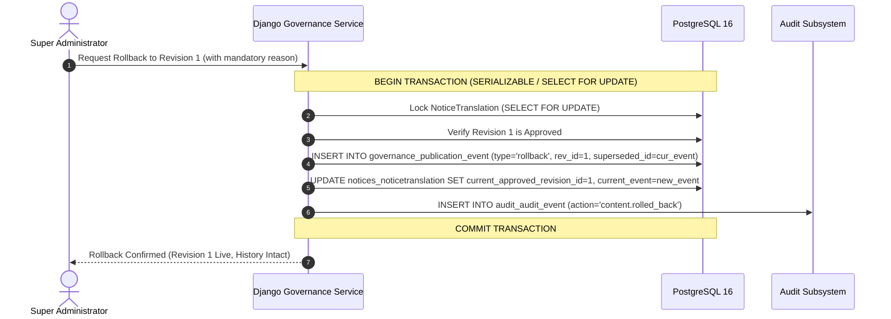

# ADR 0003: Publication Invariants, Scheduling Architecture, and Non-Destructive Rollback

- **Status:** Accepted
- **Deciders:** Senior Django Architect, PostgreSQL Database Designer, Application Security Engineer
- **Date:** 2026-10-18 (Updated: 2026-10-18)
- **Domain:** `apps.governance`, `apps.content`, `apps.notices`, `apps.documents`

---

## 1. Context and Problem Statement

When government notices, statutory resolutions, or informational pages are published or changed, legal and operational accountability requires precise answers to critical questions:
- *When exactly was an announcement visible to citizens?*
- *Who authorized the publication, withdrawal, or emergency release?*
- *What happens if a scheduled background task fails or executes late?*
- *If an error is discovered and content is rolled back, how is the timeline preserved without erasing history?*

In naive publishing systems, publishing content simply sets `is_published = True`, and scheduling relies on brittle cron jobs. If a cron worker crashes, scheduled content remains invisible, or stale workers might accidentally resurrect withdrawn notices.

Key requirements:
1. Establish **one definitive, unambiguous source of truth** for public availability.
2. Ensure that public availability is resilient even if background jobs are delayed or offline.
3. Every publication, scheduled activation, early withdrawal, urgent release, and rollback must be recorded as an **immutable, append-only historical event**.
4. A rollback must **never delete or overwrite past publication events**; it must create a **new publication event** referencing the reinstated approved revision.
5. Strict separation between **Editorial Revision Status** (`draft`, `submitted`, `approved`, `rejected`) and **Public Availability Status** (`unpublished`, `scheduled`, `published`, `withdrawn`, `archived`).

---

## 2. Decision Drivers

- **Legal Auditability:** Legal proceedings (RTI queries, tender litigation) require verifiable, tamper-evident proof of public exposure windows.
- **Fail-Safe Offline Behavior:** Citizens must not be deprived of scheduled notices if background worker processes experience downtime.
- **Serialization & Concurrency Safety:** Multiple administrators acting simultaneously must not produce conflicting states, phantom approvals, or race conditions.
- **Stable Public Visibility:** Work-in-progress drafts or unapproved replacement revisions must never take live published content offline.

---

## 3. The Unified Source of Truth for Public Availability

To prevent discrepancies between background flags, caches, and database state, GramSetu defines a single authoritative rule for whether any content revision is publicly accessible.

### 3.1 The 7 Invariance Conditions for Public Eligibility
A content revision is eligible for public citizen access **if and only if all seven of the following conditions are simultaneously satisfied**:

1. **Active Container:** The root logical container (e.g. `Notice`, `Page`, `Document`) exists and has not been soft-deleted or administratively deactivated.
2. **Matching Language Translation:** A child translation record exists for the requested language code (`language_code IN ('mr', 'hi', 'en')`).
3. **Approved Editorial State:** The translation's `current_approved_revision_id` is NOT NULL and references a `Revision` record whose `editorial_status == 'approved'`.
4. **Active Public Lifecycle Status:** The translation record's lifecycle status satisfies:
   - For active pages/notices: `status IN ('published', 'scheduled')`.
   - For historical notices: `status = 'archived'` ONLY IF `PanchayatProfile.show_archived_notices_publicly == True`.
   - If `status == 'withdrawn'`, public access is strictly severed (`404 Not Found`).
5. **Effective Start Window Reached:** The effective start timestamp satisfies `effective_from <= NOW()`.
6. **Unexpired Window:** The expiration timestamp is either unconstrained or in the future: `expires_at IS NULL OR expires_at > NOW()`.
7. **No Active Superseding Withdrawal:** The most recent `PublicationEvent` associated with this translation record is NOT of type `withdrawal`.

### 3.2 Canonical SQL Availability Query
All public views and search index queries enforce this invariant declaratively in SQL:
```sql
SELECT t.*, r.*
FROM notices_noticetranslation t
JOIN notices_notice n ON t.notice_id = n.id
JOIN notices_noticerevision r ON t.current_approved_revision_id = r.id
WHERE t.language_code = :requested_lang
  AND r.editorial_status = 'approved'
  AND (
      (t.status = 'published' AND t.effective_from <= NOW() AND (n.expires_at IS NULL OR n.expires_at > NOW()))
      OR
      (t.status = 'scheduled' AND t.effective_from <= NOW() AND (n.expires_at IS NULL OR n.expires_at > NOW()))
      OR
      (t.status = 'archived' AND :allow_public_archives = TRUE)
  );
```

---

## 4. Resolution of the 8 Scheduling & Publication Invariants

### 1. What exact conditions make a revision eligible for public access?
As formalized in Section 3.1, a revision requires an active container, matching language, `editorial_status = 'approved'`, `effective_from <= NOW()`, `expires_at > NOW()`, and no active withdrawal event.

### 2. Does an approved revision become public automatically, or only after a publication event?
**Only after an explicit publication event.**  
An approval (`ApprovalRecord`) merely certifies that the editorial text and attachments have been formally reviewed and found accurate. It does not expose content to citizens. Content becomes public only when a Super Administrator executes "Publish Now" (immediate `PublicationEvent`) or "Schedule Publication" (scheduled `PublicationEvent`). In urgent notice exceptions, the publication event is created atomically with the urgent bypass ingestion.

### 3. How does scheduled publication work if a background job runs late or fails?
**Declarative Query-Time Fallback:**  
Because the canonical SQL query evaluates `(t.status = 'published' OR (t.status = 'scheduled' AND t.effective_from <= NOW()))`, **public access activates automatically the instant `effective_from` passes**, even if the scheduled background worker (Celery/cron) is delayed, crashed, or the server is rebooting.  
The background maintenance job merely performs an asynchronous, idempotent status sweep:
```sql
UPDATE notices_noticetranslation
SET status = 'published'
WHERE status = 'scheduled' AND effective_from <= NOW();
```
This updates database indexes for fast scans, but the citizen-facing availability does not depend on worker execution timing.

### 4. Can a scheduled item be withdrawn or superseded before its scheduled time?
**Yes.**  
A Super Administrator can cancel or withdraw a scheduled publication at any time before its `effective_from`.  
- Within an atomic transaction, the translation's status is set to `withdrawn` (or reset to `draft` if canceled prior to publication), and a new `PublicationEvent` of type `withdrawal` is logged with mandatory justification.
- If a new revision is drafted, approved, and scheduled, the subsequent `PublicationEvent` explicitly references `superseded_event_id = earlier_event.id`, cleanly replacing the future schedule.

### 5. How are concurrent publish, withdraw, rollback, and expiry operations serialized?
**Pessimistic Row-Level Locking:**  
All lifecycle state mutations on a translation entity MUST acquire an exclusive row-level lock using PostgreSQL's `SELECT ... FOR UPDATE`:
```python
with transaction.atomic():
    # Exclusively lock translation record against concurrent modification
    translation = (
        NoticeTranslation.objects
        .select_for_update()
        .get(id=translation_id)
    )
    # Re-verify preconditions inside the locked transaction boundary
    if translation.status == 'withdrawn':
        raise WorkflowConflictError("Cannot publish; content has already been withdrawn.")
        
    # Execute state change, insert PublicationEvent, emit AuditEvent
```
This serializes concurrent attempts (e.g. an administrator clicking "Rollback" at the exact moment a background task attempts an expiry update). The second transaction waits for the lock and re-checks the state, preventing phantom or conflicting writes.

### 6. How does the system prevent a stale job from republishing a withdrawn or superseded revision?
Every scheduled publication job payload or database task carries the specific `scheduled_event_id` and targets only translations where:
```sql
UPDATE notices_noticetranslation
SET status = 'published'
WHERE id = :translation_id
  AND status = 'scheduled'
  AND current_publication_event_id = :scheduled_event_id
  AND effective_from <= NOW();
```
If an administrator withdrew or superseded the notice while the job was queued in Celery or cron, `status` is already `'withdrawn'` and `current_publication_event_id` has changed. The query matches 0 rows and exits as a safe no-op, preventing stale jobs from resurrecting withdrawn notices.

### 7. How is the public response kept consistent with the publication state?
1. **Cache Tag Invalidation:** Every lifecycle mutation (publish, rollback, withdraw, expire) immediately flushes corresponding HTTP and application caches via cache keys/tags.
2. **Bounded Edge Cache TTLs:** For scheduled items, public cache response headers declare a dynamic max-age:
   $$\text{TTL} = \min(\text{DefaultTTL}, \text{seconds until next scheduled effective\_from or expires\_at})$$
   This prevents caching proxies or CDNs from serving stale states across transition boundaries.

### 8. What happens when an approved replacement exists but has not yet been published?
**Live Content Remains Completely Stable:**  
- The translation row's `current_approved_revision_id` continues pointing to the active live revision (e.g., Revision 1).
- The newer approved replacement (Revision 2) exists in `PageRevision` with `editorial_status = 'approved'`.
- Citizens continue seeing Revision 1.
- Only when an administrator executes a publication event for Revision 2 does the atomic transaction update `current_approved_revision_id = revision_2.id` and `current_publication_event_id = new_event.id`.
- If Revision 2 is scheduled for a future date, Revision 1 remains publicly visible until Revision 2's `effective_from` timestamp is reached!

---

## 5. Rollback Architecture & Non-Destructive Event Ledger



Rollbacks do not alter historical records. A rollback is modeled as a new, forward-moving administrative event of type `rollback` referencing the reinstated revision, ensuring non-repudiation and complete transparency for future administrative or judicial inquiries.

---

## 6. Consequences

### Positive
- **Deterministic Citizen Experience:** Citizens never see half-published, unapproved, or accidentally resurrected announcements.
- **Worker Failure Resilience:** Scheduled content appears on time even during background worker downtime.
- **Complete Evidentiary Chain:** Every state change, cancellation, and rollback preserves who initiated the change, when it occurred, and the mandatory administrative rationale.

### Negative / Trade-offs
- **Row-Locking Contention:** Concurrency on the same translation record is serialized. Since Gram Panchayat administration involves a small team (2–5 operators), lock contention is negligible.
- **Denormalized Pointer Synchronization:** The translation record maintains denormalized pointers (`current_approved_revision_id`, `current_publication_event_id`) that must always be updated within atomic transactions alongside event insertions.

---

## 7. Implementation Notes for Future Milestones
- All state transition operations must be encapsulated in dedicated service functions inside `apps.governance.services` (e.g. `publish_revision()`, `schedule_revision()`, `rollback_revision()`, `withdraw_content()`).
- Database constraints:
  ```sql
  CONSTRAINT check_justification_required CHECK (
      event_type NOT IN ('rollback', 'urgent_publish', 'withdrawal')
      OR (justification IS NOT NULL AND LENGTH(TRIM(justification)) >= 10)
  );
  ```
